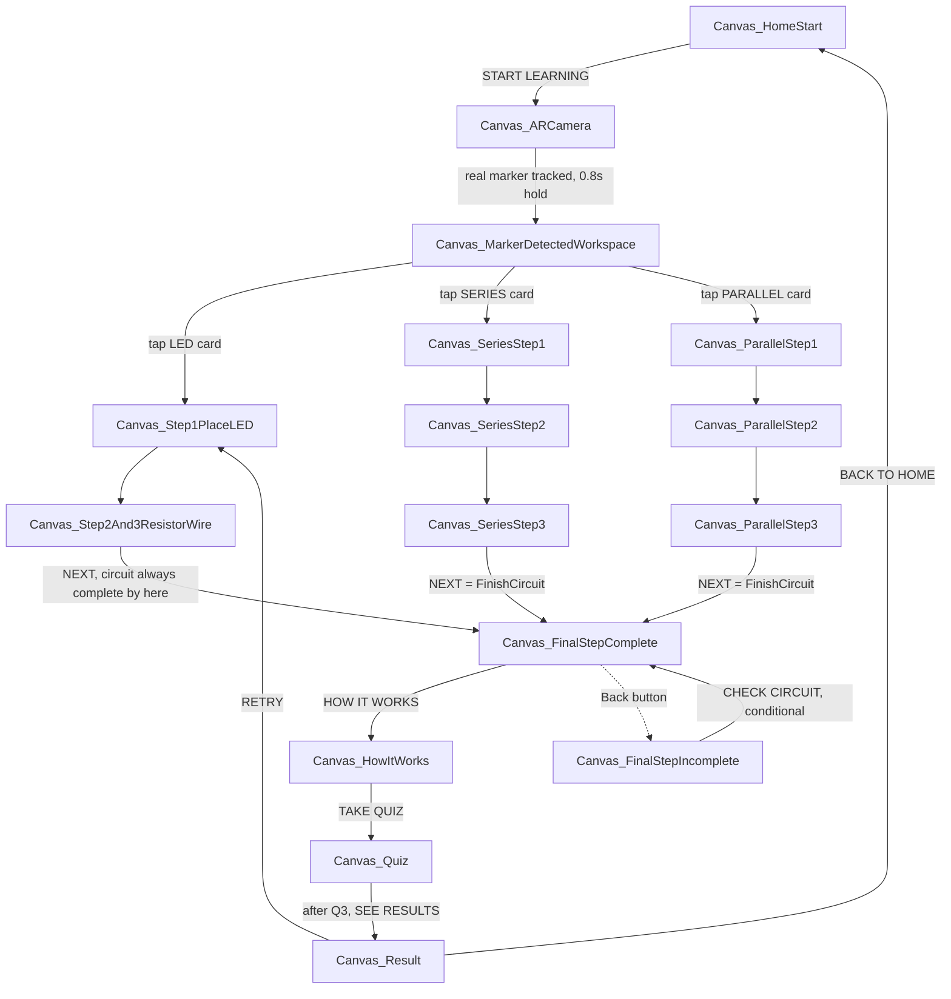
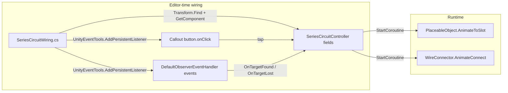
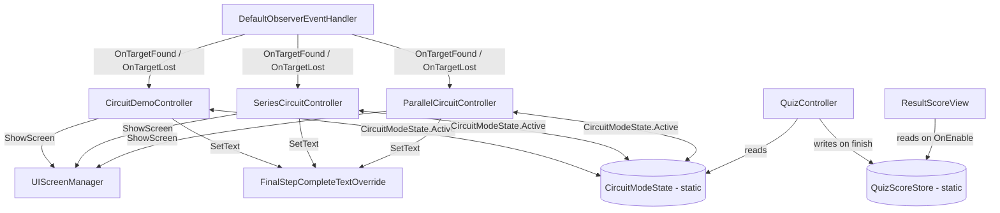
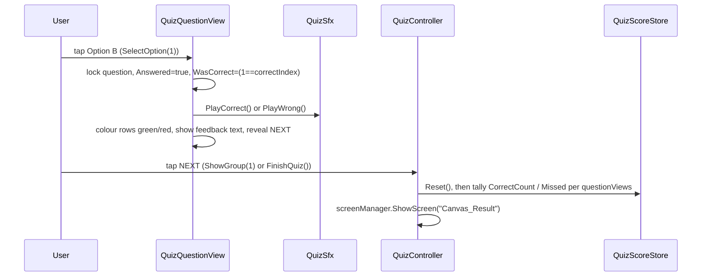

# CircuitAR — Project Flow & Methodology

> Generated by inspecting the actual project files (scripts, scenes, editor builders, prefabs,
> project settings) as they exist in this repository. Anything that could not be verified directly
> from the files is explicitly called out as such — nothing below is invented.

---

## 1. Project Overview & Workflow

**CircuitAR** is a Unity 2022.3.62f3 mobile AR app (Vuforia Engine 11.4.4, built-in render
pipeline, TextMeshPro UI) that teaches basic electronics. A student scans a printed marker card
with their phone camera; the app recognizes it, overlays a virtual breadboard, and walks them
through assembling one of three circuits by tapping floating instruction callouts. Each placement
animates a component from a "parts tray" onto the breadboard, or draws a connecting wire. After
assembly, the student takes a 3-question quiz on what they just built and sees a scored result.

### What's been built (verified from code)

- **Three circuit modes**, selectable from a "Workspace" screen, all built on one shared
  placement/animation engine:
  - **LED Circuit** (`CircuitDemoController`) — LED + resistor + 1 wire, 2 build steps.
  - **Series Circuit** (`SeriesCircuitController`) — Battery → R1 → LED1 → R2 → LED2 → Battery,
    a single chain, 3 build steps, 5 wires.
  - **Parallel Circuit** (`ParallelCircuitController`) — Battery feeding two parallel
    Resistor+LED branches that rejoin at shared rails, 3 build steps, 6 wires.
- **Real Vuforia marker tracking** (database `CircuitARTest`, target `3d_marker` —
  `Assets/StreamingAssets/Vuforia/CircuitARTest.xml/.dat`) drives screen transitions and
  shows/hides the 3D content — not simulated/timer-based.
- **Guided tap-to-place interaction**: components sit in a tray position off to the side; tapping
  a floating "callout" (a 2D UI button that tracks a 3D anchor point) animates the part along an
  arc into its breadboard slot, or draws a wire with a connect-pulse effect.
- **Pre-recorded audio narration** per screen/step, with a global mute toggle (persisted via
  `PlayerPrefs`).
- **A 3-question quiz per mode** (9 questions total) with per-answer SFX, correct/incorrect
  visual feedback, and a scored Result screen.
- **A procedural, code-generated UI**: every screen is built by an editor script
  (`Tools > Build UI > ...`) from hand-coded Figma coordinates, not hand-laid-out in the Unity
  Editor. Screens are destroyed and rebuilt from scratch every time their builder runs.

### Complete user flow (as wired in code)



**Verified caveats in this flow** (not bugs introduced by this feature — present in the shipped
behavior as currently wired):
- `Canvas_FinalStepIncomplete` ("CHECK CIRCUIT" screen) is **bypassed** in the normal path — both
  Step 2/3 (LED) and each mode's last step jump straight to `Canvas_FinalStepComplete` once every
  piece is placed, since the NEXT button is only enabled once the circuit is already complete.
  It's only reachable via the Complete screen's own Back button.
- `Canvas_HowItWorks` and `Canvas_Result`'s **RETRY** button are **LED-specific / mode-agnostic**:
  the explanation text is hardcoded to "BATTERY → RESISTOR → LED → BATTERY" and RETRY always
  navigates to the LED flow's Step 1, regardless of whether the student just finished Series or
  Parallel.
- The **mute toggle** (`AudioMuteToggle.Toggle()`) only calls `StopAudio()` on
  `CircuitDemoController` — it does not reach `SeriesCircuitController`/`ParallelCircuitController`'s
  own `AudioSource`. New clips still *won't start* while muted (every `PlayClip` checks
  `CircuitDemoController.IsAudioMuted` first), but a clip already playing on those two controllers
  when mute is tapped is not stopped mid-playback.

---

## 2. File Structure

```
Assets/
  Scripts/              Runtime C# — ships in the build
    AR/                 Circuit controllers, placement/wire engine, mode state
    UI/                 Screen manager, callouts, safe-area, quiz-adjacent UI views
    Audio/               Screen-triggered audio, mute toggle
    Quiz/                Quiz controller/view/score/result
  Editor/                Editor-only C# — Tools menu scripts, never ships
    AR/                  Scene-content builders + wiring scripts (3D side)
    UIBuilders/          One script per screen (2D UI side) + shared helpers
    Vuforia/             One-off Vuforia scene-merge/setup tools
    Migration/           One-off package-install helper
  Prefabs/AR/            Generated prefabs (Breadboard, LED, Resistor, Wire, Battery)
    Generated/           Generated materials for those prefabs
  Models/ElectronicsSet/ Source combined glTF (cc0_set_of_electronic_components.glb)
  Models/Breadboard, LED, Resistor/   Earlier-generation per-part model imports (superseded —
                          see note below)
  Audio/                 All .mp3 narration/SFX clips
  Resources/             VuforiaConfiguration.asset (license key + app settings)
  StreamingAssets/Vuforia/ CircuitARTest.xml/.dat — the marker database read at runtime
  Scenes/SampleScene.unity   The one scene the app boots into
  Scenes/VuforiaTest.unity  Isolated scene used only to originally configure/verify tracking;
                          disabled in Build Settings, not part of the shipped flow
  UI/Figma, UI/Generated  Source Figma plate images + generated sprites/fonts the UI builders read
  TextMesh Pro/           Standard TMP package assets
```

> **Note on `Assets/Models/Breadboard`, `/LED`, `/Resistor`**: these folders exist from an earlier
> per-part model import attempt (referenced in project history as the "glTF model swap" that was
> later reverted). The prefabs actually used at runtime are now built entirely from
> `Assets/Models/ElectronicsSet/cc0_set_of_electronic_components.glb` by
> `ARComponentPrefabBuilder.cs`. Whether the older per-part folders are still referenced by
> anything was not re-verified for this document — treat them as probably-unused legacy assets
> unless grep shows otherwise.

### Key files and their purpose

| File | Purpose |
|---|---|
| `Scripts/AR/CircuitDemoController.cs` | LED circuit: AR content show/hide, placement state machine, audio, Check Circuit / Finish logic. |
| `Scripts/AR/SeriesCircuitController.cs` | Series circuit: same pattern as above, scoped to its own 5-piece/5-wire chain. |
| `Scripts/AR/ParallelCircuitController.cs` | Parallel circuit: same pattern, scoped to its own 5-piece/6-wire branch topology. |
| `Scripts/AR/PlaceableObject.cs` | Generic "tray → animated arc → slot" tween for one component. |
| `Scripts/AR/WireConnector.cs` | Generic "draw line along an arc, then pulse" tween for one wire. |
| `Scripts/AR/CircuitModeState.cs` | One static field (`CircuitModeState.Active`) all three controllers read to know which mode is selected. |
| `Scripts/AR/FinalStepCompleteTextOverride.cs` | Lets all 3 controllers reuse one Complete screen with different text. |
| `Scripts/UI/UIScreenManager.cs` | Shows exactly one registered `Canvas_*` GameObject at a time. |
| `Scripts/UI/PlacementCallout.cs` | A tappable 2D instruction bubble that floats above a 3D anchor point. |
| `Scripts/Audio/ScreenAudioTrigger.cs` | Fires a `UnityEvent` when its GameObject is enabled/disabled — drives "play audio when this screen/callout appears." |
| `Scripts/Audio/AudioMuteToggle.cs` | The speaker icon button; flips the static mute flag. |
| `Scripts/Quiz/QuizController.cs` | Holds all 3 modes' question sets, shows the one matching the active mode, hands off the score. |
| `Scripts/Quiz/QuizQuestionView.cs` | One question's option-tap/feedback/SFX logic. |
| `Scripts/Quiz/QuizSfx.cs` | Plays Correct/Wrong SFX, muted by the same global flag. |
| `Scripts/Quiz/QuizScoreStore.cs` | Static hand-off of score + missed questions from Quiz → Result screen. |
| `Scripts/Quiz/ResultScoreView.cs` | Reads `QuizScoreStore` and fills in the Result screen's placeholder numbers/text. |
| `Editor/AR/ARComponentPrefabBuilder.cs` | Extracts Breadboard/LED/Resistor nodes from the combined glTF, builds a primitive Battery, saves 5 prefabs. |
| `Editor/AR/ARContentSceneBuilder.cs` | Instantiates those prefabs 3× under `ImageTarget` (ARContent / ARContent_Series / ARContent_Parallel), sets tray/slot poses, builds wires and anchors. |
| `Editor/AR/CircuitDemoWiring.cs` | Wires LED screens + 3D content references onto `CircuitDemoController`. |
| `Editor/AR/SeriesCircuitWiring.cs` / `ParallelCircuitWiring.cs` | Same, for the other two controllers. |
| `Editor/UIBuilders/*.cs` (one per screen) | Builds that screen's Canvas hierarchy from Figma coordinates every time it's run. |
| `Editor/UIBuilders/UIBuilderCommon.cs` | Shared layout/widget helpers (`Txt`, `Box`, `Callout`, `PButton`, `Wire`, `ScreenNames`, `BeginScreen`/`EndScreen`, ...). |
| `Editor/Vuforia/VuforiaMainSceneMerge.cs` | One-off: copies the working `ARCamera`/`ImageTarget` from the isolated test scene into `SampleScene`. |

---

## 3. GameObjects & Components

The scene hierarchy at runtime (root GameObjects under `SampleScene`), based on what the editor
scripts create and register:

| Root GameObject | Key component(s) | Notes |
|---|---|---|
| `ARCamera` | Vuforia `VuforiaBehaviour` (+ camera) | Copied in from `VuforiaTest.unity` by `VuforiaMainSceneMerge`. |
| `ARCamera/ImageTarget` | Vuforia `ImageTargetBehaviour`, `DefaultObserverEventHandler` | `OnTargetFound`/`OnTargetLost` drive all three controllers' `ShowARContent`/`HideARContent`. |
| `ARCamera/ImageTarget/ARContent` | — (plain container, inactive by default) | LED's Breadboard/LED/Resistor/Wire + anchors. |
| `ARCamera/ImageTarget/ARContent_Series` | — | Series's Breadboard/Battery/2×Resistor/2×LED/5×Wire + anchors. |
| `ARCamera/ImageTarget/ARContent_Parallel` | — | Parallel's equivalent, 6×Wire. |
| `CircuitDemoController` | `CircuitDemoController`, `AudioSource` (added at runtime) | Root-level sibling, not parented under `ImageTarget` — stays active regardless of tracking so its coroutines/Start() always run. |
| `SeriesCircuitController` | `SeriesCircuitController`, `AudioSource` | Same pattern. |
| `ParallelCircuitController` | `ParallelCircuitController`, `AudioSource` | Same pattern. |
| `UIScreenManager` | `UIScreenManager` | Holds the registry of every `Canvas_*` → GameObject; created on demand by `EnsureScreenManager()`. |
| `Canvas_HomeStart`, `Canvas_ARCamera`, `Canvas_MarkerDetectedWorkspace`, `Canvas_Step1PlaceLED`, `Canvas_Step2And3ResistorWire`, `Canvas_FinalStepIncomplete`, `Canvas_FinalStepComplete`, `Canvas_HowItWorks`, `Canvas_Quiz`, `Canvas_Result`, `Canvas_SeriesStep1/2/3`, `Canvas_ParallelStep1/2/3` | `Canvas`, `UIScreenManager`-registered | One per screen; `UIScreenManager.ShowScreen()` activates exactly one at a time. |

### How placement components connect (Inspector-level)

Each controller's AR-content fields are populated by its wiring script via `GameObject.Find`/
`Transform.Find` + `GetComponent<T>()`, then assigned directly (`ctrl.battery = battery;`, etc.)
and marked dirty with `EditorUtility.SetDirty`. This is **baked into the scene at edit time** —
there's no runtime `FindObjectOfType` scanning for these (apart from a couple of defensive
fallbacks, e.g. `FindObjectOfType<UIScreenManager>()` if the field is somehow unassigned).



---

## 4. Code Functionality

### `PlaceableObject.cs` (runtime)
- Fields: `trayLocalPosition/Euler`, `slotLocalPosition/Euler` (set once, at edit time, by
  `ARContentSceneBuilder.AttachPlaceable`), `IsPlaced` (read-only bool).
- `ResetToTray()` — snaps the transform back to the tray pose, clears `IsPlaced`.
- `AnimateToSlot(duration, arcHeight)` — a coroutine: linearly interpolates position/rotation
  over `duration` seconds using `Mathf.SmoothStep` easing, and adds a `Mathf.Sin`-shaped vertical
  lift (`arcHeight`) so the part visibly arcs up and over rather than sliding flat. Sets
  `IsPlaced = true` on completion.
- Called via `StartCoroutine(part.AnimateToSlot(...))` **from the controller**, not from the part
  itself — this means the animation runs even while the part's own GameObject hierarchy is
  inactive (e.g. before the marker is tracked), since the coroutine lives on the always-active
  controller.

### `WireConnector.cs` (runtime)
- Fields: `line` (a `LineRenderer`), `trayPiece` (a loose-wire visual to hide once connected),
  `startLocal`/`endLocal`, `arcHeight`, `segments`, `pulseColor`.
- `ArcPoint(u)` — same `Lerp` + `Sin` arc shape as `PlaceableObject`, parameterized 0→1.
- `AnimateConnect(drawDuration, pulseDuration)` — hides `trayPiece`, then grows the line from
  `start` to `end` by progressively revealing arc points (`SetProgress`), then runs a
  width/colour "pulse" (`Mathf.Sin`-based) to read as "current flowing." Uses a **per-instance
  material copy** (`line.material`, not `sharedMaterial`) during the pulse so one wire's colour
  change doesn't affect every other wire sharing the same base material.

### Controller pattern (shared by all three: `CircuitDemoController`, `SeriesCircuitController`, `ParallelCircuitController`)
Each controller follows the identical shape (confirmed by diffing their structure):
1. `Awake()` — adds its own `AudioSource` (2D, `playOnAwake = false`).
2. `Start()` — calls its own `ResetDemo()`/`ResetCircuit()`, which resets every placeable/wire to
   tray and refreshes callout visibility. *(Added during this session — see §11 for why this was
   necessary.)*
3. `ShowARContent()` / `HideARContent()` — gated by `if (CircuitModeState.Active != <this mode>) return;`.
   `HideARContent` runs a 1-second debounce coroutine before actually deactivating the content root,
   to absorb brief real-world tracking flicker.
4. `Select<Mode>Mode()` — sets `CircuitModeState.Active`, calls `HideSiblingContent()` (walks the
   content root's parent transform and deactivates every sibling except its own), resets its own
   state, and calls `ShowARContent()` directly (not waiting for the next Vuforia event).
5. One `PlaceX()`/`ConnectXToY()` method per sub-step, each guarded by `busy` (a simple re-entrancy
   lock) and by the previous sub-step's `IsXOk` property, so only the currently-relevant callout
   can ever actually trigger an animation.
6. `RefreshStepUI()` — the single source of truth for which callout is visible and whether each
   step's NEXT button is interactable, recomputed after every placement.
7. `FinishCircuit()`/`FinishLedCircuit()`/`CheckCircuit()` — sets the shared Complete screen's text
   via `FinalStepCompleteTextOverride.SetText(...)` and calls `UIScreenManager.ShowScreen(...)`.

### Cross-script communication



Two static classes act as the only "global state" in the project:
- **`CircuitModeState.Active`** (`CircuitMode` enum: `Led`/`Series`/`Parallel`) — which mode is
  currently selected; read by all 3 controllers and by `QuizController.ResetQuiz()`.
- **`QuizScoreStore`** — `CorrectCount`, `TotalQuestions`, `Missed` list, `HasResult` bool; written
  once by `QuizController.FinishQuiz()`, read once by `ResultScoreView.OnEnable()`.

---

## 5. Physics & Interactions

**Verified: this project uses no runtime physics.** A project-wide search for `Rigidbody`,
`Collider`, `OnCollision*`, `OnTrigger*` across `Scripts/` and `Editor/` turns up nothing except
one editor-time cleanup step: `ARComponentPrefabBuilder.BuildBatteryPrefab()` explicitly calls
`Object.DestroyImmediate(body.GetComponent<Collider>())` (and the same for the cap and each
terminal) — because `GameObject.CreatePrimitive(PrimitiveType.Cube/Cylinder)` attaches a default
Collider automatically, and this project removes it since nothing needs it.

All "interaction" is 2D UI raycasting:
- Every tappable element (`PlacementCallout`, quiz option rows, buttons) is a `UnityEngine.UI.Button`
  on a `Canvas` with the built-in `GraphicRaycaster`/`EventSystem` pipeline — standard Unity UI
  input, not a 3D raycast against the AR content.
- `PlacementCallout` bridges 2D and 3D only visually: it computes where a 3D `worldAnchor` Transform
  projects to in screen space (`Camera.WorldToScreenPoint`) and moves its own `RectTransform` there
  every frame (`LateUpdate`) — but the tap itself is still a normal 2D UI button click, not a tap
  on the 3D model.

There is therefore no "drag the part with your finger" or "touch the 3D model directly"
interaction anywhere in the codebase — every placement is **tap a 2D callout → scripted animation
moves the 3D part**, confirmed by the full absence of physics/3D-raycast code.

---

## 6. Circuit Assembly

### Shared mechanism
All three modes reuse the exact same three primitives:
- **`PlaceableObject`** for anything that moves from tray to a fixed slot (LED, Resistor, Battery).
- **`WireConnector`** for anything that draws a line between two fixed points once both its
  endpoints exist.
- **`PlacementCallout`** as the tappable trigger for either of the above.

A sub-step only becomes tappable once its prerequisite is done — this is enforced twice,
redundantly: once in the `PlaceX()`/`ConnectXToY()` methods themselves (an `if (... ) return;`
guard) and once in `RefreshStepUI()` (which hides the callout entirely). The NEXT button for each
screen only becomes `interactable = true` once every sub-step registered to that screen reports
`IsPlaced == true`.

### LED Circuit (`CircuitDemoController`) — 2 screens, 2 sub-steps shown at once on screen 2
| Step | Screen | Action | Method |
|---|---|---|---|
| 1 | `Canvas_Step1PlaceLED` | Place LED | `PlaceLed()` |
| 2 | `Canvas_Step2And3ResistorWire` | Place Resistor | `PlaceResistor()` |
| 3 | same screen | Connect wire (resistor → LED) | `ConnectWire()` |

### Series Circuit (`SeriesCircuitController`) — 3 screens, chain topology
| Step | Screen | Sub-steps (in order) |
|---|---|---|
| 1 | `Canvas_SeriesStep1` | `PlaceBattery` → `PlaceR1` → `ConnectBattToR1` |
| 2 | `Canvas_SeriesStep2` | `PlaceLed1` → `ConnectR1ToLed1` → `PlaceR2` → `ConnectLed1ToR2` |
| 3 | `Canvas_SeriesStep3` | `PlaceLed2` → `ConnectR2ToLed2` → `ConnectLed2ToBattery`, then `FinishCircuit()` |

Topology: `Battery(+) → R1 → LED1 → R2 → LED2 → Battery(−)`, a single loop, 5 `WireConnector`s.

### Parallel Circuit (`ParallelCircuitController`) — 3 screens, branch topology
| Step | Screen | Sub-steps (in order) |
|---|---|---|
| 1 | `Canvas_ParallelStep1` | `PlaceBattery` → `PlaceR1` → `ConnectBattToR1` |
| 2 | `Canvas_ParallelStep2` | `PlaceLed1` → `ConnectR1ToLed1` (branch 1 done) and independently `PlaceR2` → `PlaceLed2` → `ConnectR2ToLed2` (branch 2 done); NEXT requires **both** branches complete |
| 3 | `Canvas_ParallelStep3` | `ConnectR2ToR1` (join positive side) → `ConnectLed1ToLed2` (join negative side) → `ConnectBattToLed1` (battery − to the shared junction), then `FinishCircuit()` |

Topology: `Battery(+) → R1 →[branch1]→ LED1`, `Battery(+) → ... → R2 →[branch2]→ LED2`, both
branches' far ends tied together and back to `Battery(−)` via 6 `WireConnector`s. This is a
simplified/illustrative wiring order (chosen for a clear step-by-step narrative), not a literal
simulation of real breadboard rail connections — documented as a known simplification in the code
comments of `ARContentSceneBuilder.cs`.

### Completion
Every mode ends the same way: once its last sub-step's `IsPlaced` is true, that step's NEXT button
becomes interactable; tapping it calls `FinishCircuit()` (Series/Parallel) or
`FinishLedCircuit()`/`CheckCircuit()` (LED), which sets the shared Complete screen's chip/title/body
text via `FinalStepCompleteTextOverride.SetText(...)` and navigates there with
`UIScreenManager.ShowScreen("Canvas_FinalStepComplete")`.

---

## 7. Animations

All animation in this project is **hand-written coroutine tweening** — there is no Animator
Controller, no Timeline, and no Animation clips involved (verified: none of the scripts reference
`Animator`, `Animation`, or `PlayableDirector`).

| Animation | Script / method | Trigger | Shape |
|---|---|---|---|
| Component moves tray → slot | `PlaceableObject.AnimateToSlot` | Tapping its `PlacementCallout` (via the controller's `PlaceX()`) | `Mathf.SmoothStep` position/rotation lerp + a `Mathf.Sin` vertical arc lift |
| Wire draws itself | `WireConnector.AnimateConnect` | Tapping its `PlacementCallout` (via `ConnectXToY()`) | Progressive reveal of `segments` points along a `Lerp` + `Sin`-arc path |
| Wire "current" pulse | Second half of `AnimateConnect` | Runs automatically right after the draw finishes | Width multiplier and colour (`Color.Lerp` toward `pulseColor`) both driven by `Mathf.Sin(t/duration * π)`, back to baseline at the end |
| Callout idle pulse | `PlacementCallout.LateUpdate` | Continuous while `button.interactable` and not yet confirmed | `localScale` oscillates via `Mathf.Sin(Time.unscaledTime * pulseSpeed)` |
| Callout "confirmed" pop | `PlacementCallout.ShowConfirmed` | Called right after a placement/wire animation finishes | A quick decaying scale pop over 0.25s, label swaps to green "✓ ..." text |
| Detection pill pulse | `DetectionStatusPill.PlayFoundAnimation` | Real Vuforia `OnTargetFound`, via `CircuitDemoController.HandleMarkerFound` | Scale pulse (`Mathf.Sin`) + colour flip to green, held for `holdSeconds` |

**How animation ties into assembly**: every controller's `MoveRoutine`/`WireRoutine` coroutine does
three things in sequence — set `busy = true` and call `callout.SetBusy()` (disables the button so
it can't be tapped again mid-animation) → `yield return` the actual tween coroutine → call
`ConfirmRoutine` (shows the "✓" state, holds `confirmHoldDuration` seconds, then sets `busy = false`
and calls `RefreshStepUI()` to reveal the next callout). This serializes the whole step sequence:
nothing else can be tapped while `busy` is true.

---

## 8. Audio System

### Mechanism
- **`ScreenAudioTrigger`** is the universal hook: attached to a screen's `Canvas` root (or to one
  specific `PlacementCallout`, for mid-screen sub-step narration), it fires its `onShow`
  `UnityEvent` on `OnEnable` (after an optional `delaySeconds`) and `onHide` on `OnDisable`. Those
  events are baked at edit time (via `UnityEventTools.AddPersistentListener`) to call a specific
  controller method like `PlayStep1Audio()`.
- Each controller owns one `AudioSource` (`playOnAwake = false`, `spatialBlend = 0f` — i.e. plain
  2D narration, not positional 3D audio) and a generic `PlayClip(clip)` that stops anything
  currently playing first, so narration never overlaps.
- **Mute**: `CircuitDemoController.IsAudioMuted` is a static property backed by
  `PlayerPrefs` (key `"CircuitAR_AudioMuted"`). Every controller's `PlayClip` checks this flag
  before playing, so muting silences all future clips across all three controllers immediately —
  it just doesn't retroactively stop a Series/Parallel clip already in flight (see §1 caveat).
- **Gated buttons**: `CircuitDemoController.PlayGatedAudio(clip, button)` disables a button, plays
  the clip, and re-enables the button only once the clip's `length` has elapsed (or immediately, if
  the clip is null or muted) — used for the Workspace screen's LED card, so the student can't jump
  ahead of the narration. The other two modes' cards are **not** gated this way (per the build
  comment in `MarkerDetectedWorkspaceBuilder.cs`).
- **SFX**: `QuizSfx` is a separate, simpler component (not `ScreenAudioTrigger`-driven) — its
  `PlayCorrect()`/`PlayWrong()` are called directly from `QuizQuestionView.SelectOption()` the
  instant an answer is tapped, in parallel with the green/red visual feedback.

### Clip-to-trigger map (as wired)

| Clip (Inspector field) | Lives on | Fires when |
|---|---|---|
| `audioWelcome` | `CircuitDemoController` | AR Camera screen shown, 2s delay |
| `audioPlaceLed` | `CircuitDemoController` | Step 1 screen shown |
| `audioPlaceResistor` | `CircuitDemoController` | Step 2/3 screen shown |
| `audioConnectWire` | `CircuitDemoController` | `Callout_ConnectWire` becomes visible (resistor placed) |
| `audioWorkspace` | `CircuitDemoController` | Workspace screen shown (gates the LED card) |
| `audioCircuitComplete` | `CircuitDemoController` | Complete screen shown |
| `audioStep1`–`audioStep4` | `SeriesCircuitController` | Series Steps 1–3 screens shown; Step4 played manually inside `FinishCircuit()` |
| `audioStep1`–`audioStep4` | `ParallelCircuitController` | Same pattern for Parallel |
| `correctClip`/`wrongClip` | `QuizSfx` (on `Canvas_Quiz`) | Any quiz option tapped, correct or wrong |

All clips are imported as Vorbis, Decompress On Load, no per-platform overrides — same settings
across Welcome/Quiz/Series/Parallel/Correct/Wrong, confirmed via each `.mp3.meta` file.

---

## 9. UI & Quiz

### Screen navigation
`UIScreenManager.ShowScreen(name)` is the only way screens change. It activates the one
`GameObject` registered under that name and deactivates every other registered screen. Buttons are
wired to it at **edit time** via `UIBuilderCommon.Wire(button, targetScreenName)`, which calls
`UnityEventTools.AddStringPersistentListener(button.onClick, mgr.ShowScreen, targetScreenName)` —
so navigation works even outside Play mode, in the Device Simulator. A defensive guard added to
`ShowScreen` logs a warning and does nothing (instead of blanking every screen) if the requested
name isn't registered.

### Quiz flow
`QuizController` holds three `QuestionSet`s (`ledQuestions`, `seriesQuestions`,
`parallelQuestions`), each a parallel pair of arrays: `questionGroups` (the 3 GameObjects) and
`questionViews` (their `QuizQuestionView` components). All 9 question groups exist simultaneously
under one `Canvas_Quiz`, built in one pass by `QuizBuilder.cs`; only the active set's current group
is ever active.



- `QuizController.ResetQuiz()` (called from `OnEnable`, i.e. every time `Canvas_Quiz` becomes
  active) picks the active set based on `CircuitModeState.Active`, hides every group of every set
  (so a stale question from a previous mode can never show through), resets each view, and shows
  group 0.
- Answer validation: `QuizQuestionView.SelectOption(index)` compares `index == correctIndex`,
  locks all 4 option buttons, colours the tapped option and the correct option (green if tapped
  was right, red if wrong; correct answer always shown green), and reveals that question's own
  per-option feedback text (`perOptionFeedback[index]`, prefixed with ✓/✗).
- Score hand-off: `QuizController.FinishQuiz()` resets `QuizScoreStore`, then for each question
  either increments `CorrectCount` or appends a `MissedQuestion{ Question, CorrectAnswerLabel }`,
  sets `TotalQuestions`, and `HasResult = true` — then navigates to `Canvas_Result`.
- `ResultScoreView.OnEnable()` reads `QuizScoreStore` and overwrites the Result screen's
  design-time placeholder text (`"0/3"`, stat cards, review card) with the real numbers; if
  `HasResult` is false (Result reached without finishing a quiz) the placeholders are left as-is.
  This is mode-agnostic by construction — it works identically regardless of which of the 3 quizzes
  was just taken.

### Button callback pattern (general)
Almost every interactive element in this project is wired the same way: an editor script finds a
`UnityEngine.UI.Button` (by `Transform.Find` path) or just-created one, and calls
`UnityEventTools.AddPersistentListener`/`AddIntPersistentListener`/`AddStringPersistentListener` to
bake a method-call listener directly into the scene file — not `button.onClick.AddListener(...)` at
runtime. This is why every "Wiring" menu item (`Tools > CircuitAR > AR > 3/4/5`) must be re-run
after any UI-builder menu item that rebuilds a screen it references — rebuilding destroys and
recreates the GameObjects, so previously baked listeners are gone until re-wired.

---

## 10. Complete Execution Flow

Tracing one full play-through, cross-referencing every system:

1. **App boots** → `UIScreenManager.OnEnable()` calls `ShowScreen("Canvas_HomeStart")`.
2. **Student taps START LEARNING** → `Wire()`-baked listener calls `ShowScreen("Canvas_ARCamera")`.
   `ScreenAudioTrigger` on that canvas fires `onShow` after a 2s delay →
   `CircuitDemoController.PlayWelcomeAudio()`.
3. **Student points the camera at the physical marker card.** Vuforia's
   `DefaultObserverEventHandler` detects it for real and fires `OnTargetFound`, which is wired
   (additively) to **all three** controllers' `ShowARContent()` — only the one matching
   `CircuitModeState.Active` (default `Led`) actually activates its content root. The same event is
   wired to `CircuitDemoController.HandleMarkerFound()`, which (only while the AR Camera screen is
   the one shown) plays the pill's found-animation and, after `detectionHoldDuration`, calls
   `ShowScreen("Canvas_MarkerDetectedWorkspace")`.
4. **Workspace screen appears.** Its `ScreenAudioTrigger` plays `audioWorkspace`, gating the LED
   card's `interactable` until the clip finishes (`PlayGatedAudio`). The SERIES/PARALLEL cards are
   not gated.
5. **Student taps a card**, e.g. SERIES. Two listeners fire on that button: the plain `ShowScreen`
   nav (→ `Canvas_SeriesStep1`) and `SeriesCircuitController.SelectSeriesMode()` — which sets
   `CircuitModeState.Active = Series`, deactivates the LED/Parallel content roots
   (`HideSiblingContent()`), resets its own state (`ResetCircuit()` → only `placeBatteryCallout`
   ends up visible), and shows its own content immediately (`ShowARContent()`).
6. **Step 1 screen appears.** `ScreenAudioTrigger` plays `audioStep1`. Student taps
   "PLACE BATTERY" → `SeriesCircuitController.PlaceBattery()` → `MoveRoutine` →
   `battery.AnimateToSlot(...)` tweens it from tray to slot → `ConfirmRoutine` shows "✓" on the
   callout, holds 0.6s, then `RefreshStepUI()` reveals "PLACE RESISTOR 1". This repeats through
   `PlaceR1` → `ConnectBattToR1` (a `WireConnector.AnimateConnect` draw+pulse) until Step 1's NEXT
   becomes interactable.
7. **Steps 2 and 3** repeat the same tap → animate → confirm → reveal-next pattern for the
   remaining pieces/wires, each screen's own `ScreenAudioTrigger` playing that step's clip.
8. **Step 3's last wire connects** → NEXT becomes interactable → tapped → `FinishCircuit()`: plays
   `audioStep4`, sets the shared Complete screen's text via `FinalStepCompleteTextOverride`, calls
   `ShowScreen("Canvas_FinalStepComplete")`.
9. **Complete screen** plays `audioCircuitComplete` (its own `ScreenAudioTrigger` — note this clip
   lives on `CircuitDemoController`, shared across modes since it's the same screen). Student taps
   "HOW IT WORKS" → `Canvas_HowItWorks` (LED-specific copy regardless of mode, per §1) → "TAKE QUIZ"
   → `Canvas_Quiz`.
10. **Quiz appears.** `QuizController.OnEnable()` → `ResetQuiz()` picks `seriesQuestions` (since
    `CircuitModeState.Active == Series`), shows question 1. Each answer tap plays Correct/Wrong SFX
    via `QuizSfx` alongside the green/red visual feedback. After question 3, "SEE RESULTS" →
    `QuizController.FinishQuiz()` tallies the score into `QuizScoreStore` and shows
    `Canvas_Result`.
11. **Result screen** → `ResultScoreView.OnEnable()` reads `QuizScoreStore`, fills in the real
    score/stats/missed-question review. Student taps "BACK TO HOME" → `Canvas_HomeStart`, or
    "RETRY" → `Canvas_Step1PlaceLED` (LED flow, regardless of which mode was just taken — see §1).

---

## Cross-check summary

This document was built by reading the actual files listed in §2–§9 directly (not from memory or
assumption), including every runtime script in `Assets/Scripts/`, every controller and wiring
script in `Assets/Editor/AR/`, the full `QuizBuilder.cs`, and representative UI-builder scripts for
each screen referenced in the flow. Specific facts cross-checked against the code rather than
inferred:

- Confirmed via grep: **no Rigidbody/Collider/physics-interaction code** exists anywhere in
  runtime or editor scripts except collider removal on primitive battery parts.
- Confirmed via grep: **no Animator/Animation/Timeline usage** — all motion is coroutine tweening.
- Confirmed by reading `CircuitDemoWiring.cs`: the Final Step Incomplete screen's checklist chips
  (`Chip_Battery`, etc.) are wired to `CircuitDemoController`, and that screen is bypassed in the
  normal flow (Step 2/3's NEXT calls `FinishLedCircuit()` directly).
  the shared Complete screen; Btn_Back on Complete still points at the bypassed Incomplete screen.
- Confirmed by reading `HowItWorksBuilder.cs` and `ResultBuilder.cs`: both are LED-specific/
  mode-agnostic as stated in §1 and §10 — this is accurately reflected, not assumed.
- Confirmed by reading `AudioMuteToggle.cs`: it only reaches `CircuitDemoController.StopAudio()`,
  not the other two controllers' audio sources — documented as a caveat, not silently omitted.
- Not independently re-verified for this document (would require opening the Unity Editor):
  exact current Inspector field assignments beyond what the wiring scripts programmatically set;
  whether `Assets/Models/Breadboard`/`LED`/`Resistor` folders are referenced by anything else in
  the project; the physical printed marker card's exact artwork/labels (inferred only from the
  `WorldLabel` text strings baked by `MarkerDetectedWorkspaceBuilder.cs`, e.g. "9V BATTERY",
  "RESISTOR · 470 Ω").
