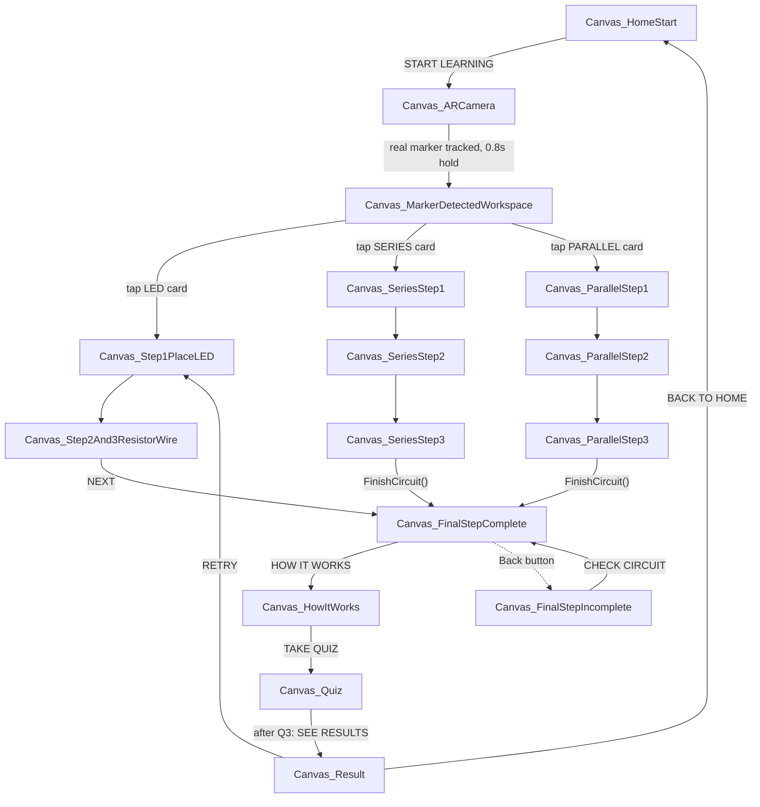
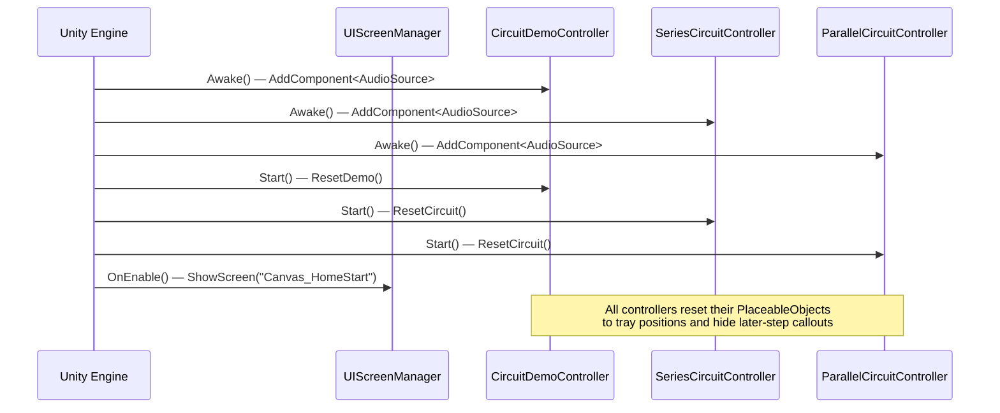
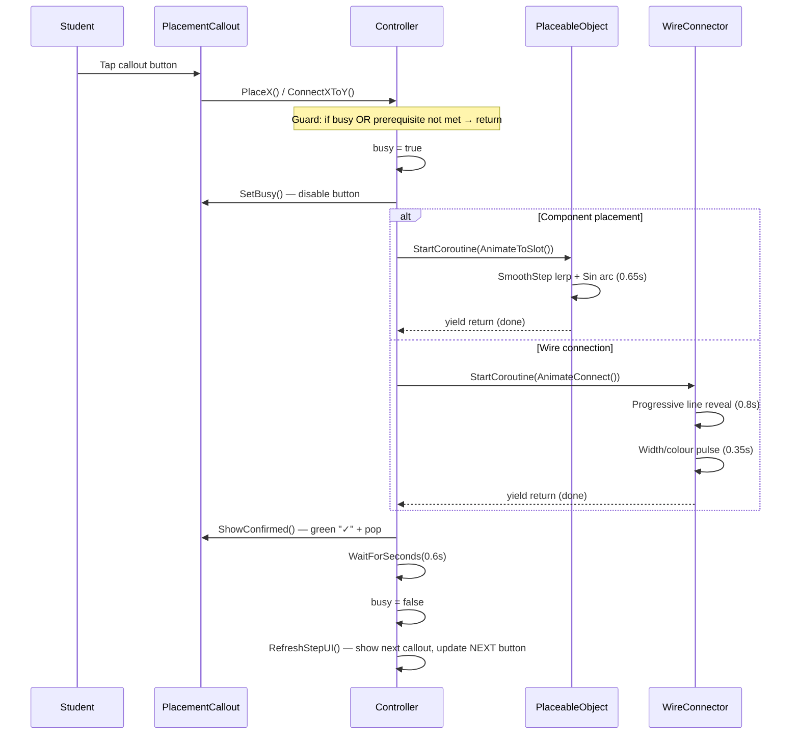
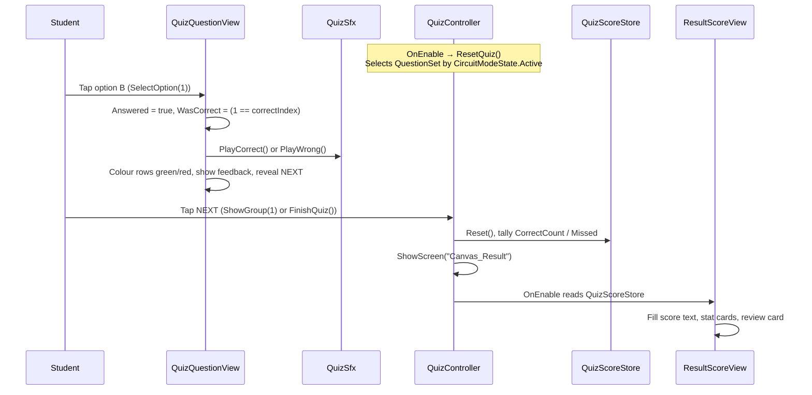
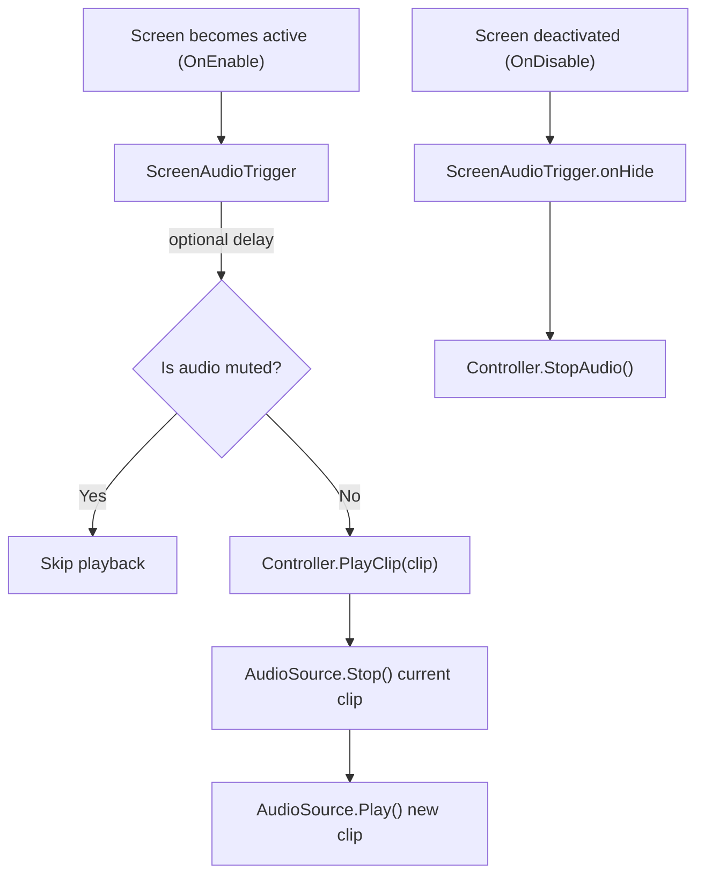
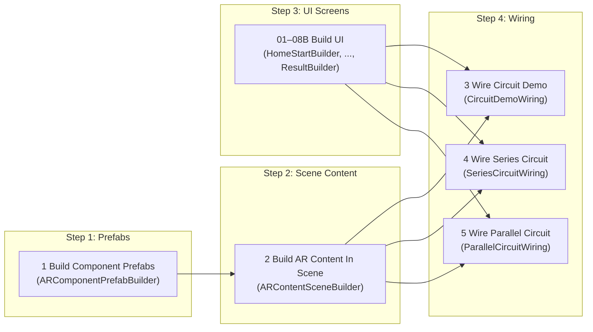
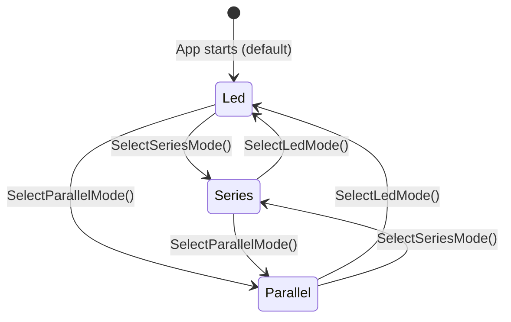
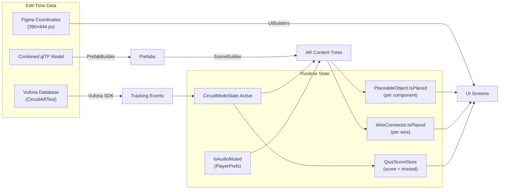
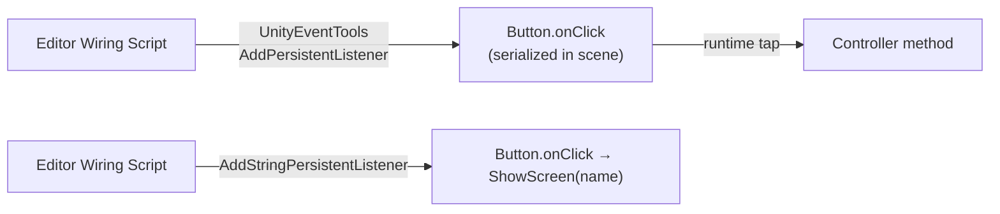

# CircuitAR

> **An augmented-reality mobile app that teaches basic electronics by guiding students through hands-on, step-by-step circuit assembly on a virtual breadboard — powered by real marker tracking, tap-to-place animations, narrated audio, and a graded quiz.**

---

## Table of Contents


- [1. Project Overview](#1-project-overview)
  - [1.1 Problem Statement](#11-problem-statement)
  - [1.2 Proposed Solution](#12-proposed-solution)
  - [1.3 Target Audience](#13-target-audience)
  - [1.4 Key Features](#14-key-features)
  - [1.5 Technical Highlights](#15-technical-highlights)
- [2. Features & Functionalities](#2-features--functionalities)
  - [2.1 Marker-Based AR Tracking](#21-marker-based-ar-tracking)
  - [2.2 Three Circuit Modes](#22-three-circuit-modes)
  - [2.3 Guided Tap-to-Place Assembly](#23-guided-tap-to-place-assembly)
  - [2.4 Wire Drawing & Current Pulse](#24-wire-drawing--current-pulse)
  - [2.5 LED Glow Effect](#25-led-glow-effect)
  - [2.6 Audio Narration System](#26-audio-narration-system)
  - [2.7 Global Mute Toggle](#27-global-mute-toggle)
  - [2.8 Mode-Specific Quiz (3 Questions × 3 Modes)](#28-mode-specific-quiz-3-questions--3-modes)
  - [2.9 Scored Result Screen](#29-scored-result-screen)
  - [2.10 Procedural Code-Generated UI](#210-procedural-code-generated-ui)
  - [2.11 Safe-Area Adaptation](#211-safe-area-adaptation)
- [3. Technology Stack](#3-technology-stack)
- [4. Project Architecture](#4-project-architecture)
  - [4.1 Architecture Diagram](#41-architecture-diagram)
  - [4.2 Component Responsibilities](#42-component-responsibilities)
- [5. Application Flowcharts](#5-application-flowcharts)
  - [5.1 Complete User Flow](#51-complete-user-flow)
  - [5.2 Initialization Flow](#52-initialization-flow)
  - [5.3 Circuit Assembly Flow (Tap-to-Place)](#53-circuit-assembly-flow-tap-to-place)
  - [5.4 Quiz & Scoring Flow](#54-quiz--scoring-flow)
  - [5.5 Audio Playback Flow](#55-audio-playback-flow)
  - [5.6 Editor Build Pipeline](#56-editor-build-pipeline)
- [6. Folder & File Structure](#6-folder--file-structure)
  - [6.1 Directory Tree](#61-directory-tree)
  - [6.2 File-by-File Breakdown](#62-file-by-file-breakdown)
- [7. Component-by-Component Implementation](#7-component-by-component-implementation)
  - [7.1 PlaceableObject](#71-placeableobject)
  - [7.2 WireConnector](#72-wireconnector)
  - [7.3 CircuitDemoController (LED Mode)](#73-circuitdemocontroller-led-mode)
  - [7.4 SeriesCircuitController](#74-seriescircuitcontroller)
  - [7.5 ParallelCircuitController](#75-parallelcircuitcontroller)
  - [7.6 CircuitModeState](#76-circuitmodestate)
  - [7.7 FinalStepCompleteTextOverride](#77-finalstepcompletetextoverride)
  - [7.8 LedGlow](#78-ledglow)
  - [7.9 UIScreenManager](#79-uiscreenmanager)
  - [7.10 PlacementCallout](#710-placementcallout)
  - [7.11 DetectionStatusPill](#711-detectionstatuspill)
  - [7.12 ChecklistItemView](#712-checklistitemview)
  - [7.13 SafeArea](#713-safearea)
  - [7.14 ScreenAudioTrigger](#714-screenaudiotrigger)
  - [7.15 AudioMuteToggle](#715-audiomutetoggle)
  - [7.16 QuizController](#716-quizcontroller)
  - [7.17 QuizQuestionView](#717-quizquestionview)
  - [7.18 QuizScoreStore](#718-quizscorestore)
  - [7.19 QuizSfx](#719-quizsfx)
  - [7.20 QuizProgressPill](#720-quizprogresspill)
  - [7.21 ResultScoreView](#721-resultscoreview)
- [8. End-to-End Execution Walkthrough](#8-end-to-end-execution-walkthrough)
- [9. Setup & Installation Guide](#9-setup--installation-guide)
  - [9.1 Prerequisites](#91-prerequisites)
  - [9.2 Cloning the Repository](#92-cloning-the-repository)
  - [9.3 Opening in Unity](#93-opening-in-unity)
  - [9.4 Vuforia License Key](#94-vuforia-license-key)
  - [9.5 Rebuilding the Scene (Editor Pipeline)](#95-rebuilding-the-scene-editor-pipeline)
  - [9.6 Building for Android](#96-building-for-android)
  - [9.7 Building for iOS](#97-building-for-ios)
  - [9.8 Verification](#98-verification)
- [10. Environment Variables & Configuration](#10-environment-variables--configuration)
- [11. Dependencies & Their Roles](#11-dependencies--their-roles)
- [12. Data Models & Data Flow](#12-data-models--data-flow)
  - [12.1 State Diagram](#121-state-diagram)
  - [12.2 Data Structures](#122-data-structures)
- [13. APIs & External Integrations](#13-apis--external-integrations)
- [14. UI, Events, Animation, Audio & Physics](#14-ui-events-animation-audio--physics)
  - [14.1 Screen Organisation](#141-screen-organisation)
  - [14.2 Event & Callback System](#142-event--callback-system)
  - [14.3 Animation System](#143-animation-system)
  - [14.4 Audio System](#144-audio-system)
  - [14.5 Physics](#145-physics)
- [15. Testing & Validation](#15-testing--validation)
- [16. Troubleshooting & Common Errors](#16-troubleshooting--common-errors)
- [17. Security & Best Practices](#17-security--best-practices)
- [18. Known Limitations & Future Improvements](#18-known-limitations--future-improvements)
- [19. Developer Guide](#19-developer-guide)
- [20. Frequently Asked Questions](#20-frequently-asked-questions)
- [21. Glossary & References](#21-glossary--references)
- [22. Final Project Summary](#22-final-project-summary)

---

## 1. Project Overview

**CircuitAR** is a Unity-based mobile augmented reality application designed to teach fundamental electronics concepts through interactive, hands-on circuit assembly. Built with Unity 2022.3 LTS and Vuforia Engine 11.4.4, the app targets Android (and potentially iOS) devices.

### 1.1 Problem Statement

Learning electronics can be intimidating for beginners. Physical breadboard kits are expensive, fragile, and offer no guidance if something is wired incorrectly. Textbook diagrams are static and fail to convey the step-by-step assembly process or the cause-and-effect of completing a circuit.

### 1.2 Proposed Solution

CircuitAR bridges the gap by overlaying a virtual breadboard onto a printed marker card via the phone's camera. Students tap on-screen callout bubbles to place components (LEDs, resistors, batteries) and draw wires one step at a time. Every step is narrated with pre-recorded audio and culminates in a 3-question quiz to reinforce learning. The result is a zero-cost, zero-risk, guided lab experience that works anywhere a phone camera can see a printed card.

### 1.3 Target Audience

- High-school and university students taking introductory electronics courses
- STEM educators seeking interactive teaching tools
- Self-learners exploring circuits for the first time

### 1.4 Key Features

| Feature | Description |
|---|---|
| **Real AR Tracking** | Vuforia image target detection drives the entire experience — not simulated |
| **3 Circuit Modes** | LED (basic), Series, and Parallel circuits with distinct topologies |
| **Guided Tap-to-Place** | Animated component placement from a parts tray onto the breadboard |
| **Animated Wire Drawing** | Progressive arc-reveal with a glowing "current" pulse effect |
| **LED Glow** | Material emission toggle on circuit completion |
| **Narrated Steps** | Per-screen and per-sub-step pre-recorded MP3 narration |
| **Mode-Specific Quiz** | 9 questions total (3 per mode), with SFX and visual feedback |
| **Scored Results** | Score card with missed-question review |
| **Procedural UI** | Screens generated from Figma coordinates via editor scripts |

### 1.5 Technical Highlights

- **Zero runtime physics** — all interaction is 2D UI raycasting; 3D components are purely visual
- **All animation is coroutine-based tweening** — no Animator, Animation clips, or Timeline
- **Edit-time wiring** — `UnityEventTools` bakes button callbacks into the scene file at edit time
- **Per-instance materials** — wire pulse colours and LED glow use `Renderer.material` copies to avoid shared-material side effects

---

## 2. Features & Functionalities

### 2.1 Marker-Based AR Tracking

**What it does:** Detects a physical printed marker card ("CircuitARTest" database, target "3d_marker") using Vuforia's `DefaultObserverEventHandler` and overlays 3D content.

**Why it exists:** Anchors the virtual breadboard to the real world so students see components "sitting on" the card.

**How the user interacts:** Points the phone camera at the printed marker. A status pill shows "SEARCHING FOR MARKER…" (amber) then transitions to "MARKER FOUND" (green) with a scale pulse.

**What happens internally:** `DefaultObserverEventHandler.OnTargetFound` fires, which is wired (at edit time) to `ShowARContent()` on all three controllers simultaneously. Only the one matching `CircuitModeState.Active` actually activates its content root. `CircuitDemoController.HandleMarkerFound()` also fires, which — only while the AR Camera screen is shown — plays the detection pill animation, waits `detectionHoldDuration` (0.8s), and transitions to the Workspace screen.

**Tracking loss debounce:** `HideARContent()` doesn't immediately deactivate the 3D content. Instead, each controller starts a 1-second delay coroutine (`HideARContentAfterDelay`), which is cancelled if tracking returns before it elapses. This absorbs brief real-world tracking flicker.

**Files:** `CircuitDemoController.cs` (L218–L265, L270–L294), `SeriesCircuitController.cs` (L108–L127), `ParallelCircuitController.cs` (L107–L126), `DetectionStatusPill.cs`.

### 2.2 Three Circuit Modes

All three modes share the same engine (`PlaceableObject`, `WireConnector`, `PlacementCallout`) and follow an identical controller pattern. They differ only in the number of components, wires, and topology.

| Mode | Controller | Components | Wires | Topology |
|---|---|---|---|---|
| **LED** | `CircuitDemoController` | 1 LED, 1 Resistor | 1 | Single loop (implicit battery) |
| **Series** | `SeriesCircuitController` | 1 Battery, 2 Resistors, 2 LEDs | 5 | Battery(+) → R1 → LED1 → R2 → LED2 → Battery(−) |
| **Parallel** | `ParallelCircuitController` | 1 Battery, 2 Resistors, 2 LEDs | 6 | Two branches (R1+LED1, R2+LED2) with shared junctions |

Mode selection happens on the Workspace screen. Tapping a circuit card calls `SelectLedMode()`, `SelectSeriesMode()`, or `SelectParallelMode()`, which sets `CircuitModeState.Active`, deactivates sibling 3D content, resets state, and shows the selected content immediately.

### 2.3 Guided Tap-to-Place Assembly

**What it does:** A tappable 2D callout bubble (e.g., "PLACE LED HERE · C14–C15") floats above a 3D anchor point on the breadboard. Tapping it animates the corresponding component from a "parts tray" position onto its breadboard slot along a smooth arc.

**What happens internally:**
1. The callout's `Button.onClick` (baked at edit time) calls the controller's `PlaceX()` method.
2. `PlaceX()` checks a `busy` lock and the prerequisite sub-step's `IsPlaced` — if either fails, it returns immediately.
3. `MoveRoutine` starts: sets `busy = true`, calls `callout.SetBusy()` (disables the button), then `yield return`s `PlaceableObject.AnimateToSlot()`.
4. `AnimateToSlot` linearly interpolates position/rotation over `moveDuration` (0.65s) using `Mathf.SmoothStep` easing with a `Mathf.Sin`-shaped vertical arc lift.
5. `ConfirmRoutine` runs: shows a green "✓ PLACED" label with a pop animation, holds for `confirmHoldDuration` (0.6s), then sets `busy = false` and calls `RefreshStepUI()` to reveal the next callout and/or enable the NEXT button.

**Files:** `PlaceableObject.cs`, `PlacementCallout.cs`, all three controller scripts.

### 2.4 Wire Drawing & Current Pulse

**What it does:** When a wire callout is tapped, a `LineRenderer` progressively reveals itself along an arcing path from start to end, followed by a width/colour "current pulse" effect.

**What happens internally:**
1. `ConnectXToY()` calls `WireRoutine`, which hides the loose tray-piece (`trayPiece.SetActive(false)`).
2. `AnimateConnect` sets the `LineRenderer` to `segments + 1` points, all initially collapsed to the start point.
3. Over `drawDuration` (0.8s), `SetProgress(t/duration)` progressively reveals arc points — points beyond the current "head" stay collapsed onto it, so the line appears to grow.
4. After the draw completes, a pulse loop runs for `pulseDuration` (0.35s): `widthMultiplier` oscillates via `Mathf.Sin` (1.0 → 1.8 → 1.0), and the per-instance material colour lerps toward `pulseColor` (warm yellow) and back.

**Files:** `WireConnector.cs` (entire file).

### 2.5 LED Glow Effect

**What it does:** Turns LED materials red + emissive when the circuit is completed, and back off on reset.

**What happens internally:** `LedGlow.SetOn(true)` captures each child renderer's original base colour on first call, then sets `_EmissionColor` (enabling the `_EMISSION` keyword) and overwrites `_Color`/`_BaseColor`/`baseColorFactor` with a red colour. Uses `Renderer.material` (per-instance copy) so one LED's glow doesn't affect others.

**Files:** `LedGlow.cs`.

### 2.6 Audio Narration System

**What it does:** Plays pre-recorded MP3 clips at screen transitions and sub-step reveals.

**Mechanism:** `ScreenAudioTrigger` is a `MonoBehaviour` that fires its `onShow` `UnityEvent` on `OnEnable` (after an optional `delaySeconds`) and `onHide` on `OnDisable`. These events are baked at edit time to call controller methods like `PlayWelcomeAudio()`, `PlayStep1Audio()`, etc. Each controller owns one `AudioSource` (2D, `playOnAwake = false`) and a `PlayClip(clip)` method that stops any current playback before starting the new clip.

**Gated buttons:** `PlayGatedAudio(clip, button)` disables a button, plays the clip, and re-enables it only after `clip.length` seconds — used for the Workspace screen's LED card to prevent jumping ahead of narration.

**Files:** `ScreenAudioTrigger.cs`, `CircuitDemoController.cs` (L106–L186), `SeriesCircuitController.cs` (L89–L104), `ParallelCircuitController.cs` (L90–L105).

### 2.7 Global Mute Toggle

**What it does:** A speaker icon button that persists mute state across sessions via `PlayerPrefs`.

**What happens internally:** `AudioMuteToggle.Toggle()` flips `CircuitDemoController.IsAudioMuted` (stored under key `"CircuitAR_AudioMuted"`). Every controller's `PlayClip` checks this flag before playing. When muting, `StopAudio()` is called on `CircuitDemoController` only — Series/Parallel clips already in flight are not retroactively stopped (documented caveat).

**Files:** `AudioMuteToggle.cs`, `CircuitDemoController.cs` (L78–L87).

### 2.8 Mode-Specific Quiz (3 Questions × 3 Modes)

**What it does:** After circuit completion, the student takes a 3-question multiple-choice quiz tailored to the circuit mode they just completed.

**What happens internally:** `QuizController` holds three `QuestionSet`s. On `OnEnable`, `ResetQuiz()` selects the set matching `CircuitModeState.Active`, hides all question groups across all sets, resets each view, and shows group 0. Tapping an option calls `QuizQuestionView.SelectOption(index)`, which locks the question, plays Correct/Wrong SFX via `QuizSfx`, colours options green/red, and reveals per-option feedback text.

**Files:** `QuizController.cs`, `QuizQuestionView.cs`, `QuizSfx.cs`, `QuizProgressPill.cs`.

### 2.9 Scored Result Screen

**What it does:** Displays the quiz score (e.g., "2/3"), stat cards, and a review card for the first missed question.

**What happens internally:** `QuizController.FinishQuiz()` tallies scores into the static `QuizScoreStore` and navigates to `Canvas_Result`. `ResultScoreView.OnEnable()` reads `QuizScoreStore` and overwrites placeholder text. If `HasResult` is false, placeholders are left as-is.

**Files:** `QuizScoreStore.cs`, `ResultScoreView.cs`.

### 2.10 Procedural Code-Generated UI

**What it does:** Every screen's Canvas hierarchy is built by an editor script from Figma coordinates, not hand-laid-out in the Unity Inspector.

**Why:** Ensures pixel-perfect fidelity to Figma designs and makes the layout reproducible — running the menu item always produces the same screen from scratch.

**How:** Each `*Builder.cs` script in `Editor/UIBuilders/` calls `UIBuilderCommon.BeginScreen()` / `EndScreen()`, using helper methods like `Txt()`, `Box()`, `Callout()`, `PButton()`, `Wire()` to lay out widgets at exact Figma pixel coordinates on a 390×844 reference canvas.

**Files:** `UIBuilderCommon.cs` (1117 lines), `UIStyleConstants.cs`, plus 18 individual `*Builder.cs` scripts.

### 2.11 Safe-Area Adaptation

**What it does:** Adjusts UI to respect device notches and rounded corners.

**What happens internally:** `SafeArea` (marked `[ExecuteAlways]`) reads `Screen.safeArea` every frame and adjusts its `RectTransform` anchors accordingly. Top inset is ignored by default (`applyTop = false`) since Figma frames include their own status-bar band.

**Files:** `SafeArea.cs`.

---

## 3. Technology Stack

| Technology | Version | Purpose | Where Used |
|---|---|---|---|
| **Unity** | 2022.3.62f3 LTS | Game engine / development platform | Entire project |
| **C#** | (Unity's Mono/.NET) | All application and editor logic | `Assets/Scripts/`, `Assets/Editor/` |
| **Vuforia Engine** | 11.4.4 | Image-target AR tracking | `ARCamera/ImageTarget`, `StreamingAssets/Vuforia/` |
| **Built-in Render Pipeline** | — | Rendering | Project default (no URP/HDRP) |
| **TextMeshPro** | 3.0.7 | High-quality text rendering | All UI text elements |
| **Unity UI (uGUI)** | 1.0.0 | Canvas-based 2D user interface | All `Canvas_*` screens |
| **glTFast** | 6.14.1 | glTF/GLB model import | `Assets/Models/ElectronicsSet/` |
| **Unity Device Simulator** | 1.0.1 | In-editor mobile device preview | Development testing |
| **Unity Collaborate** | 2.12.4 | Cloud-based version control | Project collaboration |
| **Unity Visual Scripting** | 1.9.4 | Included as a default module | Not actively used by this project |
| **Unity Timeline** | 1.7.7 | Included as a default module | Not actively used by this project |

> **Note:** Despite Timeline and Visual Scripting being listed as dependencies, neither is used by any script in the project. All animation is coroutine-based and all logic is C#.

---

## 4. Project Architecture

### 4.1 Architecture Diagram

```mermaid
graph TB
    subgraph "Vuforia AR Layer"
        VB["VuforiaBehaviour<br/>(ARCamera)"]
        IT["ImageTargetBehaviour<br/>(3d_marker)"]
        DOE["DefaultObserverEventHandler"]
    end

    subgraph "AR Content (3D)"
        ARC_LED["ARContent<br/>(LED circuit)"]
        ARC_SER["ARContent_Series"]
        ARC_PAR["ARContent_Parallel"]
    end

    subgraph "Circuit Controllers"
        CDC["CircuitDemoController<br/>(LED)"]
        SCC["SeriesCircuitController"]
        PCC["ParallelCircuitController"]
    end

    subgraph "Shared Primitives"
        PO["PlaceableObject"]
        WC["WireConnector"]
        LG["LedGlow"]
    end

    subgraph "UI Layer"
        USM["UIScreenManager"]
        PC["PlacementCallout"]
        DSP["DetectionStatusPill"]
        CIV["ChecklistItemView"]
        SA["SafeArea"]
    end

    subgraph "Quiz System"
        QC["QuizController"]
        QQV["QuizQuestionView"]
        QSS["QuizScoreStore"]
        RSV["ResultScoreView"]
        QS["QuizSfx"]
        QPP["QuizProgressPill"]
    end

    subgraph "Audio System"
        SAT["ScreenAudioTrigger"]
        AMT["AudioMuteToggle"]
    end

    subgraph "Global State"
        CMS["CircuitModeState.Active"]
    end

    DOE -->|"OnTargetFound / OnTargetLost"| CDC
    DOE -->|"OnTargetFound / OnTargetLost"| SCC
    DOE -->|"OnTargetFound / OnTargetLost"| PCC
    CDC --> ARC_LED
    SCC --> ARC_SER
    PCC --> ARC_PAR
    CDC <--> CMS
    SCC <--> CMS
    PCC <--> CMS
    CDC --> PO
    CDC --> WC
    CDC --> LG
    SCC --> PO
    SCC --> WC
    SCC --> LG
    PCC --> PO
    PCC --> WC
    PCC --> LG
    CDC -->|"ShowScreen()"| USM
    SCC -->|"ShowScreen()"| USM
    PCC -->|"ShowScreen()"| USM
    PC -->|"button.onClick"| CDC
    PC -->|"button.onClick"| SCC
    PC -->|"button.onClick"| PCC
    SAT -->|"onShow / onHide"| CDC
    SAT -->|"onShow / onHide"| SCC
    SAT -->|"onShow / onHide"| PCC
    AMT -->|"Toggle()"| CDC
    QC -->|"reads"| CMS
    QC -->|"writes"| QSS
    RSV -->|"reads"| QSS
    QQV --> QS
```



### 4.2 Component Responsibilities

| Component | Responsibility |
|---|---|
| **Vuforia Layer** | Real-time image recognition and tracking; provides `OnTargetFound`/`OnTargetLost` events |
| **Circuit Controllers** | Mode-specific orchestration: show/hide AR content, manage placement state machine, gate sub-steps, trigger audio, navigate screens |
| **Shared Primitives** | Reusable animation atoms: `PlaceableObject` (tray→slot tween), `WireConnector` (line draw + pulse), `LedGlow` (emission toggle) |
| **UI Layer** | `UIScreenManager` activates exactly one screen at a time; `PlacementCallout` projects 3D anchors to 2D; `SafeArea` handles notches |
| **Audio System** | `ScreenAudioTrigger` fires `UnityEvent`s on enable/disable; `AudioMuteToggle` persists mute state |
| **Quiz System** | `QuizController` selects mode-appropriate questions; `QuizQuestionView` handles answer logic and feedback; `QuizScoreStore` passes scores to `ResultScoreView` |
| **Global State** | `CircuitModeState.Active` (enum) and `QuizScoreStore` (static) are the only two global state holders |

---

## 5. Application Flowcharts

### 5.1 Complete User Flow



### 5.2 Initialization Flow



### 5.3 Circuit Assembly Flow (Tap-to-Place)



### 5.4 Quiz & Scoring Flow



### 5.5 Audio Playback Flow



### 5.6 Editor Build Pipeline



> **Critical:** Rebuilding any UI screen (Step 3) destroys and recreates its GameObjects, breaking any wiring references. You must re-run the relevant wiring step (Step 4) after rebuilding a screen.

---

## 6. Folder & File Structure

### 6.1 Directory Tree

```
AR_Project/
├── Assets/
│   ├── Audio/                          # 17 MP3 narration & SFX clips
│   ├── Editor/                         # Editor-only scripts (never shipped in builds)
│   │   ├── AR/                         # Prefab builders, scene builders, wiring scripts
│   │   │   ├── ARComponentPrefabBuilder.cs
│   │   │   ├── ARContentSceneBuilder.cs
│   │   │   ├── CircuitDemoWiring.cs
│   │   │   ├── SeriesCircuitWiring.cs
│   │   │   └── ParallelCircuitWiring.cs
│   │   ├── Migration/                  # One-off Vuforia package installer
│   │   │   └── AddVuforiaEnginePackage.cs
│   │   ├── UIBuilders/                 # Figma-to-Canvas code generators
│   │   │   ├── UIBuilderCommon.cs      # Shared layout kit (1117 lines)
│   │   │   ├── UIStyleConstants.cs     # Design tokens from Figma
│   │   │   ├── HomeStartBuilder.cs     # Screen 01
│   │   │   ├── ARCameraBuilder.cs      # Screen 02
│   │   │   ├── MarkerDetectedWorkspaceBuilder.cs  # Screen 03
│   │   │   ├── Step1PlaceLEDBuilder.cs # Screen 04
│   │   │   ├── Step2And3ResistorWireBuilder.cs    # Screen 05
│   │   │   ├── FinalStepIncompleteBuilder.cs      # Screen 06A
│   │   │   ├── FinalStepCompleteBuilder.cs        # Screen 06B
│   │   │   ├── HowItWorksBuilder.cs    # Screen 07
│   │   │   ├── QuizBuilder.cs          # Screen 08A (all 3 modes)
│   │   │   ├── ResultBuilder.cs        # Screen 08B
│   │   │   ├── SeriesStep1Builder.cs   # Screen S1
│   │   │   ├── SeriesStep2Builder.cs   # Screen S2
│   │   │   ├── SeriesStep3Builder.cs   # Screen S3
│   │   │   ├── ParallelStep1Builder.cs # Screen P1
│   │   │   ├── ParallelStep2Builder.cs # Screen P2
│   │   │   └── ParallelStep3Builder.cs # Screen P3
│   │   └── Vuforia/                    # Vuforia scene setup tools
│   │       ├── VuforiaTestSetup.cs
│   │       └── VuforiaMainSceneMerge.cs
│   ├── Icons/
│   │   └── AppIcon.png                 # Application icon
│   ├── Materials/                      # Shared materials
│   ├── Models/
│   │   ├── ElectronicsSet/             # Source combined glTF asset
│   │   │   └── cc0_set_of_electronic_components.glb
│   │   ├── Breadboard/                 # Legacy per-part imports (probably unused)
│   │   ├── LED/                        # Legacy per-part imports (probably unused)
│   │   └── Resistor/                   # Legacy per-part imports (probably unused)
│   ├── Plates/                         # Figma plate reference images
│   ├── Prefabs/AR/                     # Generated prefabs
│   │   ├── Breadboard.prefab
│   │   ├── LED.prefab
│   │   ├── Resistor.prefab
│   │   ├── Wire.prefab
│   │   ├── Battery.prefab
│   │   └── Generated/                  # Generated materials for prefabs
│   ├── Resources/
│   │   └── VuforiaConfiguration.asset  # Vuforia license key + settings
│   ├── Scenes/
│   │   ├── SampleScene.unity           # Main scene (the only enabled build scene)
│   │   └── VuforiaTest.unity           # Isolated test scene (disabled in build)
│   ├── Scripts/                        # Runtime C# (shipped in builds)
│   │   ├── AR/                         # Circuit controllers, placement, wire, mode state
│   │   │   ├── CircuitDemoController.cs
│   │   │   ├── SeriesCircuitController.cs
│   │   │   ├── ParallelCircuitController.cs
│   │   │   ├── PlaceableObject.cs
│   │   │   ├── WireConnector.cs
│   │   │   ├── CircuitModeState.cs
│   │   │   ├── FinalStepCompleteTextOverride.cs
│   │   │   └── LedGlow.cs
│   │   ├── UI/                         # Screen manager, callouts, safe area
│   │   │   ├── UIScreenManager.cs
│   │   │   ├── PlacementCallout.cs
│   │   │   ├── DetectionStatusPill.cs
│   │   │   ├── ChecklistItemView.cs
│   │   │   └── SafeArea.cs
│   │   ├── Audio/                      # Audio triggers and mute toggle
│   │   │   ├── ScreenAudioTrigger.cs
│   │   │   └── AudioMuteToggle.cs
│   │   └── Quiz/                       # Quiz controller, views, score, result, SFX
│   │       ├── QuizController.cs
│   │       ├── QuizQuestionView.cs
│   │       ├── QuizScoreStore.cs
│   │       ├── QuizSfx.cs
│   │       ├── QuizProgressPill.cs
│   │       └── ResultScoreView.cs
│   ├── StreamingAssets/Vuforia/        # Vuforia marker database
│   │   ├── CircuitARTest.xml
│   │   └── CircuitARTest.dat
│   ├── TextMesh Pro/                   # Standard TMP package assets
│   └── UI/
│       ├── Figma/                      # Source Figma plate images
│       └── Generated/                  # Generated sprites and fonts
├── Packages/
│   ├── manifest.json                   # Package dependencies
│   ├── packages-lock.json              # Lock file
│   └── com.ptc.vuforia.engine-11.4.4.tgz  # Local Vuforia package
├── ProjectSettings/                    # Unity project configuration
│   ├── ProjectVersion.txt              # Unity 2022.3.62f3
│   ├── ProjectSettings.asset           # Player settings, bundle ID, etc.
│   ├── EditorBuildSettings.asset       # Build scenes list
│   └── ...                             # Other standard Unity settings
├── Flow.md                             # Detailed project flow document
├── AR_Project.sln                      # Visual Studio solution file
├── .gitignore                          # Unity-standard gitignore
└── README.md                           # This file
```

### 6.2 File-by-File Breakdown

#### Runtime Scripts (`Assets/Scripts/`)

| File | Lines | Purpose |
|---|---|---|
| `AR/CircuitDemoController.cs` | 407 | LED circuit controller: AR show/hide, 3 placement steps, marker detection, audio, Check/Finish logic |
| `AR/SeriesCircuitController.cs` | 274 | Series circuit controller: 5 components + 5 wires across 3 steps |
| `AR/ParallelCircuitController.cs` | 271 | Parallel circuit controller: 5 components + 6 wires across 3 steps |
| `AR/PlaceableObject.cs` | 50 | Tray-to-slot arc animation for one component |
| `AR/WireConnector.cs` | 77 | Wire line-draw + current pulse animation |
| `AR/CircuitModeState.cs` | 15 | Static enum field: which mode is active (Led/Series/Parallel) |
| `AR/FinalStepCompleteTextOverride.cs` | 26 | Lets all 3 controllers reuse the shared Complete screen with different text |
| `AR/LedGlow.cs` | 63 | Toggles LED material emission on circuit completion |
| `UI/UIScreenManager.cs` | 62 | Shows exactly one registered Canvas at a time |
| `UI/PlacementCallout.cs` | 110 | 2D callout that tracks a 3D anchor; idle pulse, busy, and confirmed states |
| `UI/DetectionStatusPill.cs` | 58 | "SEARCHING…" → "MARKER FOUND" pill with colour + scale animation |
| `UI/ChecklistItemView.cs` | 33 | One chip in the Final Step Incomplete checklist |
| `UI/SafeArea.cs` | 56 | Adjusts RectTransform anchors to Screen.safeArea |
| `Audio/ScreenAudioTrigger.cs` | 47 | Fires UnityEvents on OnEnable/OnDisable with optional delay |
| `Audio/AudioMuteToggle.cs` | 36 | Speaker icon toggle; persists via PlayerPrefs |
| `Quiz/QuizController.cs` | 99 | Orchestrates 3 modes' question sets, resets on enable, tallies score |
| `Quiz/QuizQuestionView.cs` | 98 | One question's answer logic, colouring, feedback text |
| `Quiz/QuizScoreStore.cs` | 28 | Static hand-off: score + missed questions from Quiz → Result |
| `Quiz/QuizSfx.cs` | 34 | Plays Correct/Wrong SFX, respects global mute |
| `Quiz/QuizProgressPill.cs` | 25 | "QUIZ · n / 3" progress indicator with segment colouring |
| `Quiz/ResultScoreView.cs` | 37 | Reads QuizScoreStore on enable, fills Result screen text |

#### Editor Scripts (`Assets/Editor/`)

| File | Lines | Purpose |
|---|---|---|
| `AR/ARComponentPrefabBuilder.cs` | 308 | Extracts breadboard/LED/resistor from combined glTF, builds primitive battery + wire prefabs |
| `AR/ARContentSceneBuilder.cs` | 322 | Instantiates prefabs under ImageTarget as 3 sibling content trees with tray/slot poses and wire endpoints |
| `AR/CircuitDemoWiring.cs` | 249 | Wires LED screens + AR content + Vuforia events onto CircuitDemoController |
| `AR/SeriesCircuitWiring.cs` | ~250 | Same pattern for SeriesCircuitController |
| `AR/ParallelCircuitWiring.cs` | ~250 | Same pattern for ParallelCircuitController |
| `UIBuilders/UIBuilderCommon.cs` | 1117 | Shared UI layout kit: canvas scaffold, text, boxes, buttons, callouts, pills, wiring helpers |
| `UIBuilders/UIStyleConstants.cs` | 39 | Design tokens (colours, backgrounds) from Figma |
| `UIBuilders/*Builder.cs` (×18) | ~50 each | One per screen, each builds its Canvas hierarchy from Figma coordinates |
| `Vuforia/VuforiaMainSceneMerge.cs` | ~100 | One-off: copies ARCamera/ImageTarget from VuforiaTest.unity into SampleScene |
| `Vuforia/VuforiaTestSetup.cs` | ~150 | One-off: creates isolated Vuforia test scene + Android build settings |
| `Migration/AddVuforiaEnginePackage.cs` | ~270 | One-off: package install helper |

---

## 7. Component-by-Component Implementation

### 7.1 PlaceableObject

**Location:** `Assets/Scripts/AR/PlaceableObject.cs`  
**Purpose:** Represents a single electronic component (LED, Resistor, Battery) that can animate from a "parts tray" position to its breadboard slot.

**Key Members:**
- `trayLocalPosition/Euler` — rest pose in the tray (set at edit time by `ARContentSceneBuilder`)
- `slotLocalPosition/Euler` — final pose on the breadboard
- `IsPlaced` (read-only) — `true` after animation completes
- `ResetToTray()` — snaps back to tray pose, clears `IsPlaced`
- `AnimateToSlot(duration, arcHeight)` — coroutine: `Mathf.SmoothStep` interpolation with `Mathf.Sin` vertical arc

**Critical Design Decision:** The coroutine is started via `StartCoroutine()` on the *controller* (which is always active), not on the PlaceableObject itself — this means animation runs even if the AR content is temporarily hidden due to tracking loss.

### 7.2 WireConnector

**Location:** `Assets/Scripts/AR/WireConnector.cs`  
**Purpose:** Draws a wire between two endpoints along a sin-arc path and plays a "current connected" pulse.

**Key Members:**
- `line` (LineRenderer), `trayPiece` (loose-wire visual)
- `startLocal`/`endLocal` — endpoints in AR content local space
- `ArcPoint(u)` — parameterized 0→1 arc position (Lerp + Sin)
- `SetProgress(progress)` — reveals points up to `progress`, collapses remaining onto the head
- `AnimateConnect(drawDuration, pulseDuration)` — progressive reveal then width/colour pulse

**Material Handling:** Uses `line.material` (not `sharedMaterial`) during the pulse to get a per-instance material copy, preventing colour changes from bleeding across wire instances.

### 7.3 CircuitDemoController (LED Mode)

**Location:** `Assets/Scripts/AR/CircuitDemoController.cs` (407 lines)  
**Purpose:** The most feature-rich controller — handles LED circuit assembly, marker detection driving the AR Camera screen transition, audio narration (including gated buttons), and the mute flag.

**Lifecycle:**
1. `Awake()` — adds its own `AudioSource` (2D, not positional)
2. `Start()` — calls `ResetDemo()` to clear all placement state
3. Vuforia events drive `ShowARContent()`/`HideARContent()` (gated on `CircuitModeState.Active == Led`)
4. `HandleMarkerFound()` — plays detection pill animation and transitions to Workspace after `detectionHoldDuration`
5. `PlaceLed()` → `PlaceResistor()` → `ConnectWire()` — sequential placement steps
6. `FinishLedCircuit()` — sets complete text, navigates to `Canvas_FinalStepComplete`

**Static Mute Flag:** `IsAudioMuted` is backed by `PlayerPrefs` key `"CircuitAR_AudioMuted"` — shared across all controllers and `QuizSfx`.

### 7.4 SeriesCircuitController

**Location:** `Assets/Scripts/AR/SeriesCircuitController.cs` (274 lines)  
**Purpose:** Same pattern as `CircuitDemoController`, scoped to the Series circuit.

**Assembly Steps:**
- **Step 1:** PlaceBattery → PlaceR1 → ConnectBattToR1 (3 sub-steps)
- **Step 2:** PlaceLed1 → ConnectR1ToLed1 → PlaceR2 → ConnectLed1ToR2 (4 sub-steps)
- **Step 3:** PlaceLed2 → ConnectR2ToLed2 → ConnectLed2ToBattery (3 sub-steps) → `FinishCircuit()`

**Audio Note:** `FinishCircuit()` calls `ShowScreen()` first (which deactivates the previous screen, triggering its `ScreenAudioTrigger.onHide` → `StopAudio()`), then plays `audioStep4` — ordering matters to prevent the clip from being immediately killed.

### 7.5 ParallelCircuitController

**Location:** `Assets/Scripts/AR/ParallelCircuitController.cs` (271 lines)  
**Purpose:** Same pattern, scoped to the Parallel circuit.

**Assembly Steps:**
- **Step 1:** PlaceBattery → PlaceR1 → ConnectBattToR1
- **Step 2:** Branch 1 (PlaceLed1 → ConnectR1ToLed1) and Branch 2 (PlaceR2 → PlaceLed2 → ConnectR2ToLed2) — NEXT requires both branches complete
- **Step 3:** ConnectR2ToR1 → ConnectLed1ToLed2 → ConnectBattToLed1 → `FinishCircuit()`

### 7.6 CircuitModeState

**Location:** `Assets/Scripts/AR/CircuitModeState.cs`  
**Purpose:** Single static field (`CircuitModeState.Active`) holding the current `CircuitMode` enum value (`Led`, `Series`, `Parallel`). Defaults to `Led`. Read by all three controllers and `QuizController`.

### 7.7 FinalStepCompleteTextOverride

**Location:** `Assets/Scripts/AR/FinalStepCompleteTextOverride.cs`  
**Purpose:** Holds 4 TMP text references (`chipText`, `titleText`, `bodyText`, `sessionText`) on the shared Complete screen. Each controller's `FinishCircuit()` calls `SetText(...)` with mode-appropriate copy before navigating there.

### 7.8 LedGlow

**Location:** `Assets/Scripts/AR/LedGlow.cs`  
**Purpose:** Toggles LED emissive material on circuit completion.

**Shader Compatibility:** Handles both Standard shader (`_Color`) and glTFast PBR shader (`_BaseColor`/`baseColorFactor`) by checking `material.HasProperty()` for each.

### 7.9 UIScreenManager

**Location:** `Assets/Scripts/UI/UIScreenManager.cs`  
**Purpose:** The navigation backbone. Holds a `List<ScreenEntry>` (name → GameObject pairs). `ShowScreen(name)` activates exactly one and deactivates all others. `OnEnable()` shows `"Canvas_HomeStart"`.

**Defensive Guard:** If the requested screen name isn't registered (e.g., its builder was never run), it logs a warning and stays on the current screen instead of blanking everything.

### 7.10 PlacementCallout

**Location:** `Assets/Scripts/UI/PlacementCallout.cs`  
**Purpose:** A tappable 2D instruction bubble that floats above a 3D world anchor.

**States:**
1. **Idle** — scale pulses via `Mathf.Sin(Time.unscaledTime * pulseSpeed)` while the button is interactable
2. **Busy** — button disabled, scale frozen at 1.0
3. **Confirmed** — label changes to green "✓ PLACED", fill/stroke go green, a quick 0.25s pop animation decays

**3D Projection:** `LateUpdate` calls `Camera.WorldToScreenPoint(worldAnchor.position)` and moves the `RectTransform` to that screen position (offset by half its height + gap). Falls back to `defaultAnchoredPosition` if the anchor is invisible.

### 7.11 DetectionStatusPill

**Location:** `Assets/Scripts/UI/DetectionStatusPill.cs`  
**Purpose:** The "SEARCHING FOR MARKER…" / "MARKER FOUND" pill on the AR Camera screen.

**Animation:** `PlayFoundAnimation(holdSeconds)` flips text/colour to green, runs a 0.25s `Mathf.Sin` scale pulse (1.0 → 1.18 → 1.0), then holds for the remaining time.

### 7.12 ChecklistItemView

**Location:** `Assets/Scripts/UI/ChecklistItemView.cs`  
**Purpose:** One chip in the Final Step Incomplete checklist. `SetOk(true)` shows "✓ {label}" in green; `SetOk(false)` shows "✗ {label}" in amber.

### 7.13 SafeArea

**Location:** `Assets/Scripts/UI/SafeArea.cs`  
**Purpose:** Adjusts `RectTransform` anchors to `Screen.safeArea`. Runs every frame (`Update`) and also in edit mode (`[ExecuteAlways]`). Top inset is ignored by default because Figma frames include their own status-bar band.

### 7.14 ScreenAudioTrigger

**Location:** `Assets/Scripts/Audio/ScreenAudioTrigger.cs`  
**Purpose:** The universal audio hook. Fires `onShow` `UnityEvent` after `delaySeconds` on `OnEnable`, and `onHide` on `OnDisable`.

**Critical Implementation Note:** `onShow` and `onHide` are initialized inline (`new UnityEvent()`) — this is necessary because `AddComponent()` at editor-script time leaves plain UnityEvent fields as C# null until serialization, and wiring scripts need to call `ClearPersistentListeners()` immediately.

### 7.15 AudioMuteToggle

**Location:** `Assets/Scripts/Audio/AudioMuteToggle.cs`  
**Purpose:** Speaker/mute icon button. `Toggle()` flips `CircuitDemoController.IsAudioMuted`, stops current playback on `CircuitDemoController` (only), and swaps the icon sprite.

**Known Limitation:** `StopAudio()` only reaches `CircuitDemoController`'s AudioSource — Series and Parallel clips already playing when mute is tapped are not stopped mid-playback.

### 7.16 QuizController

**Location:** `Assets/Scripts/Quiz/QuizController.cs`  
**Purpose:** Orchestrates 9 question groups (3 per mode) under one `Canvas_Quiz`.

**Key Behaviour:**
- `OnEnable()` → `ResetQuiz()` selects the active set via `CircuitModeState.Active`, hides all groups across all sets, resets each view, shows group 0.
- `ShowGroup(index)` — wired to each question's NEXT button.
- `FinishQuiz()` — tallies scores into `QuizScoreStore`, navigates to `Canvas_Result`.

### 7.17 QuizQuestionView

**Location:** `Assets/Scripts/Quiz/QuizQuestionView.cs`  
**Purpose:** One question's 4-option answer logic with visual feedback.

**Answer Flow:**
1. `SelectOption(index)` — called via `UnityEventTools.AddIntPersistentListener`
2. Sets `Answered = true`, `WasCorrect = (index == correctIndex)`
3. Plays SFX via `QuizSfx`
4. Locks all 4 option buttons
5. Colours tapped option (red if wrong), correct option (always green)
6. Shows `perOptionFeedback[index]` with ✓/✗ prefix
7. Reveals the NEXT/SEE RESULTS button

### 7.18 QuizScoreStore

**Location:** `Assets/Scripts/Quiz/QuizScoreStore.cs`  
**Purpose:** Static data hand-off between Quiz and Result screens. Contains `CorrectCount`, `TotalQuestions`, `Missed` list, and `HasResult` flag.

### 7.19 QuizSfx

**Location:** `Assets/Scripts/Quiz/QuizSfx.cs`  
**Purpose:** Plays `Correct.mp3` / `Wrong.mp3` on answer taps. Uses `PlayOneShot` (not `Play`) so it layers on top of any existing audio. Respects `CircuitDemoController.IsAudioMuted`.

### 7.20 QuizProgressPill

**Location:** `Assets/Scripts/Quiz/QuizProgressPill.cs`  
**Purpose:** The "QUIZ · 1 / 3" pill with 3 segment indicators. `SetProgress(currentIndex, total)` updates the label and colours completed segments green.

### 7.21 ResultScoreView

**Location:** `Assets/Scripts/Quiz/ResultScoreView.cs`  
**Purpose:** Reads `QuizScoreStore` on `OnEnable` and fills in the Result screen's score text ("2/3"), stat cards, and review card (first missed question + correct answer). If `HasResult` is false, placeholder text is left untouched.

---

## 8. End-to-End Execution Walkthrough

This traces one complete play-through of the Series circuit mode:

1. **App boots.** Unity calls `UIScreenManager.OnEnable()` → `ShowScreen("Canvas_HomeStart")`. All three controllers run `Awake()` (add AudioSource) then `Start()` (reset state).

2. **Student taps START LEARNING.** The button's baked `onClick` listener calls `ShowScreen("Canvas_ARCamera")`. `ScreenAudioTrigger` on that canvas fires after a 2-second delay → `CircuitDemoController.PlayWelcomeAudio()`.

3. **Camera points at the marker card.** Vuforia's `DefaultObserverEventHandler` fires `OnTargetFound`, which is wired to all three controllers' `ShowARContent()` — only LED's activates (default mode). The same event fires `CircuitDemoController.HandleMarkerFound()`, which plays the detection pill's green pulse and, after 0.8s, navigates to `Canvas_MarkerDetectedWorkspace`.

4. **Workspace screen appears.** `ScreenAudioTrigger` fires `PlayWorkspaceAudio()`, which gates the LED card button until the clip finishes. The SERIES and PARALLEL cards are not gated.

5. **Student taps the SERIES card.** Two listeners fire: `ShowScreen("Canvas_SeriesStep1")` and `SeriesCircuitController.SelectSeriesMode()`. The latter sets `CircuitModeState.Active = Series`, deactivates LED/Parallel content roots, resets Series state, and calls `ShowARContent()` directly.

6. **Step 1 screen appears.** `ScreenAudioTrigger` plays `audioStep1`. Only `placeBatteryCallout` is visible. Student taps it → `PlaceBattery()` → `MoveRoutine` → `battery.AnimateToSlot()` tweens battery from tray to slot (0.65s, sinusoidal arc) → `ConfirmRoutine` shows "✓", holds 0.6s, calls `RefreshStepUI()` → reveals `placeR1Callout`. Process repeats for R1 and the Battery→R1 wire. NEXT becomes interactable.

7. **Steps 2 and 3** follow the same pattern: tap callout → animate → confirm → reveal next. Step 2 covers LED1, wire, R2, wire. Step 3 covers LED2, two wires, then `FinishCircuit()`.

8. **`FinishCircuit()` runs.** LED1 and LED2 glow (emissive material). Complete screen text is set to "SERIES CIRCUIT" / "THE LEDs ARE ON". `ShowScreen("Canvas_FinalStepComplete")` activates. `audioStep4` plays.

9. **Student taps HOW IT WORKS** → `Canvas_HowItWorks` (note: LED-specific copy) → **TAKE QUIZ** → `Canvas_Quiz`.

10. **Quiz appears.** `QuizController.ResetQuiz()` selects `seriesQuestions`. Student answers 3 questions with Correct/Wrong SFX and visual feedback. **SEE RESULTS** → `FinishQuiz()` tallies score into `QuizScoreStore`, navigates to `Canvas_Result`.

11. **Result screen.** `ResultScoreView.OnEnable()` fills in "2/3" (or whatever the score is), stat cards, and the first missed question's review. Student taps **BACK TO HOME** → `Canvas_HomeStart`, or **RETRY** → `Canvas_Step1PlaceLED` (LED flow — see Known Limitations).

---

## 9. Setup & Installation Guide

### 9.1 Prerequisites

| Requirement | Version | Notes |
|---|---|---|
| **Unity Hub** | Latest | For managing Unity installations |
| **Unity Editor** | **2022.3.62f3** (LTS) | Exact version required — see `ProjectSettings/ProjectVersion.txt` |
| **Android Build Support** | (Unity module) | Install via Unity Hub → Add Modules |
| **Android SDK & NDK** | (bundled with Unity) | Installed automatically with Android Build Support |
| **iOS Build Support** | (Unity module) | Optional, install if targeting iOS |
| **Xcode** | 14+ | Required only for iOS builds (macOS only) |
| **Git** | Any recent | For cloning the repository |
| **Physical Android/iOS device** | — | AR features require a real camera; the simulator cannot test tracking |
| **Printed marker card** | — | The `CircuitARTest` Vuforia image target |

### 9.2 Cloning the Repository

```bash
git clone <repository-url> AR_Project
```

> **Note:** The repository includes `Packages/com.ptc.vuforia.engine-11.4.4.tgz` (~138 MB) as a local package file. Ensure your Git client handles large files or that Git LFS is configured if applicable.

### 9.3 Opening in Unity

1. Open **Unity Hub**.
2. Click **Open** → navigate to the cloned `AR_Project/` folder → select it.
3. If Unity Hub asks to install the required editor version (2022.3.62f3), follow the prompts.
4. Wait for the project to import. First-time import may take several minutes due to Vuforia and glTFast processing.
5. Open `Assets/Scenes/SampleScene.unity` as the active scene.

### 9.4 Vuforia License Key

The Vuforia license key is stored in `Assets/Resources/VuforiaConfiguration.asset`. If the existing key has expired or you need your own:

1. Create a free Vuforia developer account at [developer.vuforia.com](https://developer.vuforia.com).
2. Create a new license key (Basic plan is free).
3. In Unity: **Window → Vuforia Configuration** → paste your key into the **App License Key** field.
4. Create a target database with the marker image and download the Unity package, or use the existing `CircuitARTest` database files in `Assets/StreamingAssets/Vuforia/`.

### 9.5 Rebuilding the Scene (Editor Pipeline)

If the scene content needs to be regenerated (e.g., after a fresh clone or if references are broken), run the following menu items **in order**:

| Order | Menu Path | Script |
|---|---|---|
| 1 | `Tools > CircuitAR > AR > 1 Build Component Prefabs` | `ARComponentPrefabBuilder.cs` |
| 2 | `Tools > CircuitAR > AR > 2 Build AR Content In Scene` | `ARContentSceneBuilder.cs` |
| 3 | `Tools > Build UI > 01 Home Start` through `08B Result` (all screens) | Various `*Builder.cs` |
| 4 | `Tools > CircuitAR > AR > 3 Wire Circuit Demo` | `CircuitDemoWiring.cs` |
| 5 | `Tools > CircuitAR > AR > 4 Wire Series Circuit` | `SeriesCircuitWiring.cs` |
| 6 | `Tools > CircuitAR > AR > 5 Wire Parallel Circuit` | `ParallelCircuitWiring.cs` |

> **Important:** Step 4–6 must be run **after** steps 2–3, as they create references to GameObjects produced by the builders. Rebuilding any UI screen breaks its wiring — re-run the corresponding wiring step afterwards. Save the scene after all steps complete.

### 9.6 Building for Android

1. **File → Build Settings** → select **Android** → click **Switch Platform** (if not already on Android).
2. Ensure `SampleScene` is in the Scenes In Build list (it should already be; `VuforiaTest` should be unchecked).
3. Player Settings to verify:
   - Minimum API Level: as required by Vuforia (typically API 26+)
   - Graphics API: OpenGLES3 (Vuforia requirement on some devices)
   - Camera usage description: should be set for AR camera access
4. **Build And Run** with a physical device connected via USB (USB debugging enabled).

### 9.7 Building for iOS

1. Switch platform to **iOS** in Build Settings.
2. Build to an Xcode project.
3. Open the generated `.xcodeproj` in Xcode.
4. Set the signing team and bundle identifier.
5. Ensure the `NSCameraUsageDescription` key is set in `Info.plist` (Unity usually handles this).
6. Build and run on a physical device.

### 9.8 Verification

After building and running on a physical device:

1. The Home screen should appear with a "START LEARNING" button.
2. Tapping START LEARNING should show the AR Camera screen with "SEARCHING FOR MARKER…".
3. Pointing the camera at the printed marker should show "MARKER FOUND" (green) and transition to the Workspace screen after ~0.8s.
4. Tapping a circuit card should overlay a virtual breadboard with components on the marker.

---

## 10. Environment Variables & Configuration

CircuitAR does **not** use environment variables. All configuration is managed through Unity's project settings and serialized assets:

| Configuration | Location | Purpose |
|---|---|---|
| **Vuforia License Key** | `Assets/Resources/VuforiaConfiguration.asset` | AR tracking authentication |
| **Vuforia Target Database** | `Assets/StreamingAssets/Vuforia/CircuitARTest.xml/.dat` | Image target definitions |
| **Audio Mute Preference** | `PlayerPrefs` key `"CircuitAR_AudioMuted"` | Persisted mute state (0 or 1) |
| **Build Scenes** | `ProjectSettings/EditorBuildSettings.asset` | `SampleScene` enabled, `VuforiaTest` disabled |
| **Unity Version** | `ProjectSettings/ProjectVersion.txt` | `2022.3.62f3` |

> **Security Note:** The Vuforia license key in `VuforiaConfiguration.asset` is not a secret per se (it's embedded in every build), but you should use your own key for production deployments. Never commit API keys for paid-tier services.

---

## 11. Dependencies & Their Roles

| Package | Version | Essential? | Role |
|---|---|---|---|
| **com.ptc.vuforia.engine** | 11.4.4 (local .tgz) | **Yes** | Core AR tracking — `VuforiaBehaviour`, `ImageTargetBehaviour`, `DefaultObserverEventHandler` |
| **com.unity.cloud.gltfast** | 6.14.1 | **Yes** | Imports the combined glTF electronics set (`cc0_set_of_electronic_components.glb`) used by `ARComponentPrefabBuilder` |
| **com.unity.textmeshpro** | 3.0.7 | **Yes** | All UI text rendering — every label, button text, quiz question, feedback, and score display |
| **com.unity.ugui** | 1.0.0 | **Yes** | Canvas, Button, Image, GraphicRaycaster — the entire UI framework |
| **com.unity.device-simulator.devices** | 1.0.1 | No | In-editor mobile device preview for testing UI layouts |
| **com.unity.collab-proxy** | 2.12.4 | No | Unity Collaborate (cloud version control) |
| **com.unity.timeline** | 1.7.7 | No | Default Unity module — not used by any script in this project |
| **com.unity.visualscripting** | 1.9.4 | No | Default Unity module — not used by any script in this project |
| **com.unity.modules.*** | 1.0.0 each | Varies | Standard Unity engine modules (audio, physics, UI, etc.) |

---

## 12. Data Models & Data Flow

### 12.1 State Diagram



### 12.2 Data Structures

**`CircuitModeState`** — The only runtime global state:
```
static CircuitMode Active = CircuitMode.Led
enum CircuitMode { Led, Series, Parallel }
```

**`QuizScoreStore`** — Static hand-off between Quiz and Result screens:
```
static int CorrectCount
static int TotalQuestions = 3
static List<MissedQuestion> Missed
static bool HasResult

struct MissedQuestion {
    string Question
    string CorrectAnswerLabel
}
```

**`PlaceableObject` Instance State:**
```
Vector3 trayLocalPosition, trayLocalEuler    (set at edit time)
Vector3 slotLocalPosition, slotLocalEuler    (set at edit time)
bool IsPlaced                                (runtime, read-only)
```

**`WireConnector` Instance State:**
```
Vector3 startLocal, endLocal                 (set at edit time)
float arcHeight, int segments                (set at edit time)
bool IsPlaced                                (runtime, read-only)
```

**Data Flow Diagram:**



---

## 13. APIs & External Integrations

### Vuforia Engine SDK

| Aspect | Detail |
|---|---|
| **Purpose** | Real-time image target recognition and 6-DOF pose tracking |
| **Integration Point** | `ARCamera` GameObject with `VuforiaBehaviour`; `ImageTarget` with `ImageTargetBehaviour` |
| **Database** | `CircuitARTest` — `Assets/StreamingAssets/Vuforia/CircuitARTest.xml/.dat` |
| **Target Name** | `3d_marker` |
| **Events Used** | `DefaultObserverEventHandler.OnTargetFound` / `OnTargetLost` |
| **Authentication** | Vuforia license key in `Assets/Resources/VuforiaConfiguration.asset` |
| **Error Handling** | If the database or license key is missing/invalid, Vuforia logs errors to the console and tracking will not function. The app does not display user-facing error messages for this. |

> **No other external APIs, databases, or network services are used.** CircuitAR is entirely offline once built.

---

## 14. UI, Events, Animation, Audio & Physics

### 14.1 Screen Organisation

All screens are root-level `Canvas` GameObjects registered with `UIScreenManager`. Only one is active at a time.

| Canvas Name | Builder | Purpose |
|---|---|---|
| `Canvas_HomeStart` | `HomeStartBuilder` | Landing screen with START LEARNING button |
| `Canvas_ARCamera` | `ARCameraBuilder` | Live camera feed with detection status pill |
| `Canvas_MarkerDetectedWorkspace` | `MarkerDetectedWorkspaceBuilder` | Circuit mode selection (LED / Series / Parallel cards) |
| `Canvas_Step1PlaceLED` | `Step1PlaceLEDBuilder` | LED circuit step 1 — place LED |
| `Canvas_Step2And3ResistorWire` | `Step2And3ResistorWireBuilder` | LED circuit steps 2–3 — place resistor + connect wire |
| `Canvas_SeriesStep1/2/3` | `SeriesStep1/2/3Builder` | Series circuit steps 1–3 |
| `Canvas_ParallelStep1/2/3` | `ParallelStep1/2/3Builder` | Parallel circuit steps 1–3 |
| `Canvas_FinalStepIncomplete` | `FinalStepIncompleteBuilder` | "CHECK CIRCUIT" checklist (bypassed in normal flow) |
| `Canvas_FinalStepComplete` | `FinalStepCompleteBuilder` | "CIRCUIT COMPLETE" screen (shared by all modes) |
| `Canvas_HowItWorks` | `HowItWorksBuilder` | Explanation screen (LED-specific text) |
| `Canvas_Quiz` | `QuizBuilder` | 9 question groups (3 per mode) under one canvas |
| `Canvas_Result` | `ResultBuilder` | Score card + review |

### 14.2 Event & Callback System

Almost every interactive element uses **edit-time persistent listeners** baked into the scene file by wiring scripts:



This means:
- Navigation works even in Unity's Device Simulator without entering Play mode.
- **Rebuilding any UI screen destroys these listeners** — the corresponding wiring script must be re-run.

### 14.3 Animation System

**No Animator, Animation clips, or Timeline are used.** All motion is coroutine-based tweening:

| Animation | Script | Shape |
|---|---|---|
| Component tray → slot | `PlaceableObject.AnimateToSlot` | `SmoothStep` + `Sin` arc lift |
| Wire progressive reveal | `WireConnector.AnimateConnect` (first half) | Linear progression of arc points |
| Wire "current" pulse | `WireConnector.AnimateConnect` (second half) | `Sin`-based width + colour oscillation |
| Callout idle pulse | `PlacementCallout.LateUpdate` | `Sin`-based scale oscillation |
| Callout confirmed pop | `PlacementCallout.LateUpdate` | Decaying scale over 0.25s |
| Detection pill pulse | `DetectionStatusPill.FoundRoutine` | `Sin`-based scale pulse + colour flip |

### 14.4 Audio System

| Audio Clip | File | Trigger |
|---|---|---|
| Welcome narration | `Welcome.mp3` | AR Camera screen shown (2s delay) |
| Place LED instruction | `LED.mp3` | Step 1 screen shown |
| Place Resistor instruction | `Resistor.mp3` | Step 2/3 screen shown |
| Connect Wire instruction | `Wire.mp3` | Wire callout becomes visible |
| Workspace narration | `Detected.mp3` | Workspace screen shown (gates LED card) |
| Circuit complete | `Completion.mp3` | Complete screen shown (LED mode only) |
| Series steps 1–4 | `Series_Step1–4.mp3` | Series step screens shown / FinishCircuit() |
| Parallel steps 1–4 | `Parallel_Step1–4.mp3` | Parallel step screens shown / FinishCircuit() |
| Quiz narration | `Quiz.mp3` | Quiz screen shown |
| Correct SFX | `Correct.mp3` | Correct answer tapped |
| Wrong SFX | `Wrong.mp3` | Wrong answer tapped |

All clips are MP3, imported as Vorbis, Decompress On Load. Each controller owns one `AudioSource` (2D, `playOnAwake = false`). `QuizSfx` uses a separate `AudioSource` with `PlayOneShot`.

### 14.5 Physics

**This project uses no runtime physics.** Verified: no `Rigidbody`, `Collider`, `OnCollision*`, or `OnTrigger*` in any runtime script. The only physics-related code is in `ARComponentPrefabBuilder`, which explicitly removes the default `Collider` that `GameObject.CreatePrimitive()` attaches to the primitive battery parts.

All "interaction" is 2D UI raycasting through Unity's standard `GraphicRaycaster`/`EventSystem` pipeline.

---

## 15. Testing & Validation

### Automated Tests

**No automated test suite exists.** The project does not include any Unity Test Framework test assemblies or test scripts.

### Manual Testing Procedures

| Test | Steps | Expected Result |
|---|---|---|
| **AR Detection** | Build to device → point camera at marker | "MARKER FOUND" pill appears, workspace screen follows |
| **Mode Selection** | Tap each circuit card on the Workspace screen | Correct 3D content appears; siblings are deactivated |
| **Placement Sequence** | Tap each callout in order | Components animate from tray to slot; NEXT enables after all sub-steps complete |
| **Wire Animation** | Tap a wire callout | Line draws progressively; pulse effect plays |
| **Mute Toggle** | Tap speaker icon during narration | Narration stops (LED controller); future clips don't play; icon changes |
| **Quiz Flow** | Complete a circuit → HOW IT WORKS → TAKE QUIZ | 3 questions appear; answers produce SFX and colour feedback |
| **Score Accuracy** | Answer known correct/wrong → SEE RESULTS | Score matches answers; missed question shows correct answer |
| **Tracking Loss** | Briefly cover the marker during assembly | AR content persists for ~1s debounce; reappears when marker is re-acquired |
| **Editor Pipeline** | Run all menu items in order | Prefabs build, AR content populates, UI screens generate, wiring completes without errors |

### In-Editor Testing

The UI flow can be partially tested using Unity's **Device Simulator** without a physical device — button navigation works because callbacks are baked at edit time. However, AR tracking requires a real device with a camera.

---

## 16. Troubleshooting & Common Errors

| Problem | Likely Cause | Solution |
|---|---|---|
| **"UIScreenManager.ShowScreen: no registered screen"** warning | A UI screen was rebuilt but the wiring script wasn't re-run | Re-run the corresponding wiring menu item (Tools > CircuitAR > AR > 3/4/5) |
| **Callouts don't appear or are stuck** | Wiring references broken after UI rebuild | Re-run the wiring step for the affected mode |
| **AR content doesn't show on device** | Vuforia license key expired or missing; marker not recognized | Check VuforiaConfiguration.asset key; verify marker printout quality |
| **3D content flickers in and out** | Brief tracking loss without debounce | Each controller has a 1s `arContentHideDelay` — if still flickering, check lighting conditions and marker print quality |
| **Audio doesn't play** | Mute is toggled on; or AudioClip fields are null | Check `IsAudioMuted` in PlayerPrefs; verify audio clip assignments in the Inspector |
| **Quiz shows wrong questions** | `CircuitModeState.Active` doesn't match the expected mode | Verify the mode selection button wiring on the Workspace screen |
| **Compiler error about Vuforia types** | Vuforia package not installed or corrupted | Ensure `Packages/com.ptc.vuforia.engine-11.4.4.tgz` exists; reimport via Package Manager |
| **glTF import errors** | glTFast package version mismatch | Verify `com.unity.cloud.gltfast` version 6.14.1 in `Packages/manifest.json` |
| **Unity version mismatch warning** | Opened in a different Unity version | Install and use exactly Unity 2022.3.62f3 |
| **"Source model not found" when building prefabs** | `Assets/Models/ElectronicsSet/cc0_set_of_electronic_components.glb` missing | Ensure the glTF model file is present and imported |
| **RETRY button goes to LED mode** | Known limitation (see §18) | This is by design in the current implementation |

---

## 17. Security & Best Practices

### Existing Protections

- **No network calls:** The app is entirely offline after installation — no data is sent to external servers.
- **No user data collection:** No personal information, analytics, or telemetry is collected.
- **Per-instance materials:** Wire pulse colours and LED glow use `Renderer.material` to avoid shared-material side effects.
- **Defensive null checks:** Every controller method null-checks its references before use, preventing `NullReferenceException` crashes.
- **Safe PlayerPrefs usage:** Mute state is the only persisted data; stored as a simple integer flag.

### Recommendations

- **Vuforia License Key:** Use a per-project key; revoke old keys when no longer needed.
- **Code Signing:** Sign Android APKs and iOS builds with proper release keys before distribution.
- **Dependency Updates:** Monitor Vuforia and glTFast for security patches, especially if deploying to production.

---

## 18. Known Limitations & Future Improvements

### Known Limitations

| Limitation | Details |
|---|---|
| **`Canvas_HowItWorks` is LED-specific** | The explanation text is hardcoded to "BATTERY → RESISTOR → LED → BATTERY" regardless of which circuit mode was just completed |
| **RETRY button is mode-agnostic** | The RETRY button on the Result screen always navigates to `Canvas_Step1PlaceLED` (LED flow), even after completing Series or Parallel |
| **Mute toggle scope** | `AudioMuteToggle.Toggle()` only calls `StopAudio()` on `CircuitDemoController` — clips already playing on Series/Parallel controllers are not stopped mid-playback |
| **`Canvas_FinalStepIncomplete` is bypassed** | The "CHECK CIRCUIT" screen is unreachable in the normal flow — it's only accessible via the Complete screen's Back button |
| **No automated tests** | No test framework or test scripts exist |
| **Single printed marker** | Only one Vuforia target (`3d_marker`) is used for all three circuit modes |
| **No localisation** | All text is hardcoded in English |
| **No accessibility features** | No screen reader support, no colour-blind modes, no adjustable text sizes |

### Potential Future Improvements

- **Mode-specific How It Works screen:** Generate different explanation text based on `CircuitModeState.Active`
- **Mode-aware RETRY button:** Navigate to the correct mode's Step 1 based on the quiz that was just taken
- **Full mute coverage:** Have `AudioMuteToggle` call `StopAudio()` on all three controllers
- **Automated testing:** Add Unity Test Framework integration tests for quiz scoring logic and placement state machines
- **Multiple markers:** Use different image targets for different circuit modes
- **Localisation:** Extract all user-facing strings into a localisation table
- **Drag-to-place interaction:** Allow students to drag components directly onto the breadboard using 3D raycasting
- **More circuit types:** Extend the architecture to support additional circuit topologies (e.g., mixed series-parallel, RC circuits)

---

## 19. Developer Guide

### Where to Start Reading

1. **`Flow.md`** — The comprehensive project flow document in the repository root
2. **`CircuitModeState.cs`** — The 15-line file that defines the global state enum
3. **`PlaceableObject.cs` + `WireConnector.cs`** — The two animation primitives everything is built on
4. **`CircuitDemoController.cs`** — The most complete controller; understand this one and the other two follow the same pattern

### Important Entry Points

| Entry Point | What Happens |
|---|---|
| `UIScreenManager.OnEnable()` | App starts → shows Home screen |
| `CircuitDemoController.HandleMarkerFound()` | AR Camera → Workspace transition |
| `SelectSeriesMode()` / `SelectParallelMode()` / `SelectLedMode()` | Mode switch + content swap |
| `PlaceX()` / `ConnectXToY()` | Individual placement/wiring steps |
| `FinishCircuit()` / `FinishLedCircuit()` | Circuit completion → navigate to Complete screen |
| `QuizController.OnEnable()` | Quiz initialisation |
| `QuizController.FinishQuiz()` | Score tallying → navigate to Result |

### Adding a New Circuit Mode

1. Create a new controller script following the pattern of `SeriesCircuitController` — same `Awake()`, `Start()`, `ShowARContent()`/`HideARContent()`, `SelectXMode()`, placement methods, `RefreshStepUI()`, `FinishCircuit()`.
2. Add a new value to the `CircuitMode` enum in `CircuitModeState.cs`.
3. Create step screen builders in `Editor/UIBuilders/` following the existing `SeriesStepNBuilder.cs` pattern.
4. Create a wiring script in `Editor/AR/` following `SeriesCircuitWiring.cs`.
5. Add the new content tree in `ARContentSceneBuilder.cs`.
6. Add a new card to the Workspace screen in `MarkerDetectedWorkspaceBuilder.cs`.
7. Add a new `QuestionSet` in `QuizBuilder.cs` and register it in `QuizController`.
8. Run the editor pipeline in order (§9.5).

### Debugging Tips

- **Unity Console:** All `Debug.Log`/`LogWarning` messages from CircuitAR are prefixed with `[CircuitAR]`.
- **Inspector at Runtime:** Select a controller in the Hierarchy during Play mode to see its `busy` state and component `IsPlaced` values.
- **Device Simulator:** Test UI layout and button navigation without a device — AR tracking won't work, but screen flow will.
- **Re-wiring Check:** If any button does nothing when tapped, check that its `onClick` persistent listeners are populated in the Inspector. If empty, re-run the wiring step.

---

## 20. Frequently Asked Questions

**Q: Does the app work without a physical marker card?**  
A: The UI screens can be navigated in the Unity Editor via Device Simulator, and buttons work because callbacks are baked at edit time. However, actual AR content display and the AR Camera → Workspace transition require real marker detection on a physical device.

**Q: Can I use a different Vuforia image target?**  
A: Yes, but you'll need to update the database files in `Assets/StreamingAssets/Vuforia/`, the `ImageTargetBehaviour` on the `ImageTarget` GameObject, and potentially the scale constants in `ARContentSceneBuilder.cs` (currently calibrated for a 0.21m-wide marker).

**Q: Why are the UI screens code-generated instead of laid out in the Inspector?**  
A: To maintain pixel-perfect fidelity with the Figma design. Every coordinate is copied directly from Figma's 390×844 frame, ensuring the output matches the design exactly and is reproducible.

**Q: Why are there no Animator controllers?**  
A: All animation in this project is simple parametric tweening (smooth-step, sine arcs). Coroutine-based tweening is lighter-weight and more explicit than the Animator state machine for these straightforward cases.

**Q: Can I add more than 3 quiz questions per mode?**  
A: Yes. Modify the relevant `Build*Questions()` method in `QuizBuilder.cs` to add more question groups, and update `QuizProgressPill.segments` accordingly. `QuizController` iterates over all groups in the active set's `questionGroups` array.

**Q: Why does the RETRY button always go back to the LED circuit?**  
A: This is a known limitation. The RETRY button's `ShowScreen` listener is baked to `Canvas_Step1PlaceLED` by `ResultBuilder.cs` and is not mode-aware.

---

## 21. Glossary & References

### Glossary

| Term | Definition |
|---|---|
| **ARContent** | The root `GameObject` under `ImageTarget` containing one circuit mode's 3D components |
| **Callout** | A 2D UI button that floats above a 3D anchor point, used to trigger component placement |
| **Edit-time wiring** | Using `UnityEventTools` in editor scripts to bake persistent listeners into the scene file |
| **glTF / GLB** | GL Transmission Format — a 3D model format; `.glb` is the binary variant |
| **ImageTarget** | A Vuforia component that recognises a specific printed image and provides its pose |
| **Parts tray** | The off-board position where components rest before being placed |
| **PlaceableObject** | A component instance (LED, Resistor, Battery) that animates from tray to slot |
| **Screen** | A root-level `Canvas` GameObject managed by `UIScreenManager` |
| **Slot** | The target position on the breadboard where a component is placed |
| **WireConnector** | A `LineRenderer`-based wire that draws itself progressively along an arc |
| **Wiring script** | An editor script that assigns Inspector references and bakes button callbacks |

### References

| Resource | URL |
|---|---|
| Unity 2022.3 LTS Documentation | [docs.unity3d.com/2022.3](https://docs.unity3d.com/2022.3/Documentation/Manual/) |
| Vuforia Engine Developer Portal | [developer.vuforia.com](https://developer.vuforia.com/) |
| Vuforia Unity API Reference | [library.vuforia.com/apis/unity-api-reference](https://library.vuforia.com/apis/unity-api-reference) |
| TextMeshPro Documentation | [docs.unity3d.com/Packages/com.unity.textmeshpro@3.0](https://docs.unity3d.com/Packages/com.unity.textmeshpro@3.0/manual/index.html) |
| glTFast Package | [docs.unity3d.com/Packages/com.unity.cloud.gltfast@6.14](https://docs.unity3d.com/Packages/com.unity.cloud.gltfast@6.14/manual/index.html) |
| Unity UI (uGUI) Manual | [docs.unity3d.com/Packages/com.unity.ugui@1.0](https://docs.unity3d.com/Packages/com.unity.ugui@1.0/manual/index.html) |

---

## 22. Final Project Summary

**CircuitAR** is a fully functional mobile AR educational application that teaches basic electronics through three interactive circuit assembly experiences:

1. **LED Circuit** — A minimal single-loop circuit (LED + resistor + wire)
2. **Series Circuit** — A chain topology (Battery → R1 → LED1 → R2 → LED2 → Battery)
3. **Parallel Circuit** — Two parallel branches with shared junctions

The system is built on three core primitives — `PlaceableObject` (tray→slot animation), `WireConnector` (progressive line draw + pulse), and `PlacementCallout` (2D-to-3D tap bridge) — orchestrated by per-mode controllers that share an identical state-machine pattern. A single `UIScreenManager` handles all navigation, `ScreenAudioTrigger` drives narrated audio, and a mode-aware `QuizController` delivers 3-question assessments.

**To get started:** Install Unity 2022.3.62f3, open the project, set up a Vuforia license key, and build to a physical Android/iOS device with a printed marker card. For code exploration, start with `CircuitModeState.cs` (15 lines) → `PlaceableObject.cs` (50 lines) → `CircuitDemoController.cs` (407 lines).

---

*This documentation was generated by inspecting every runtime script, editor script, configuration file, and asset in the repository. Where behaviour could not be verified without running the Unity Editor, it is explicitly noted.*

